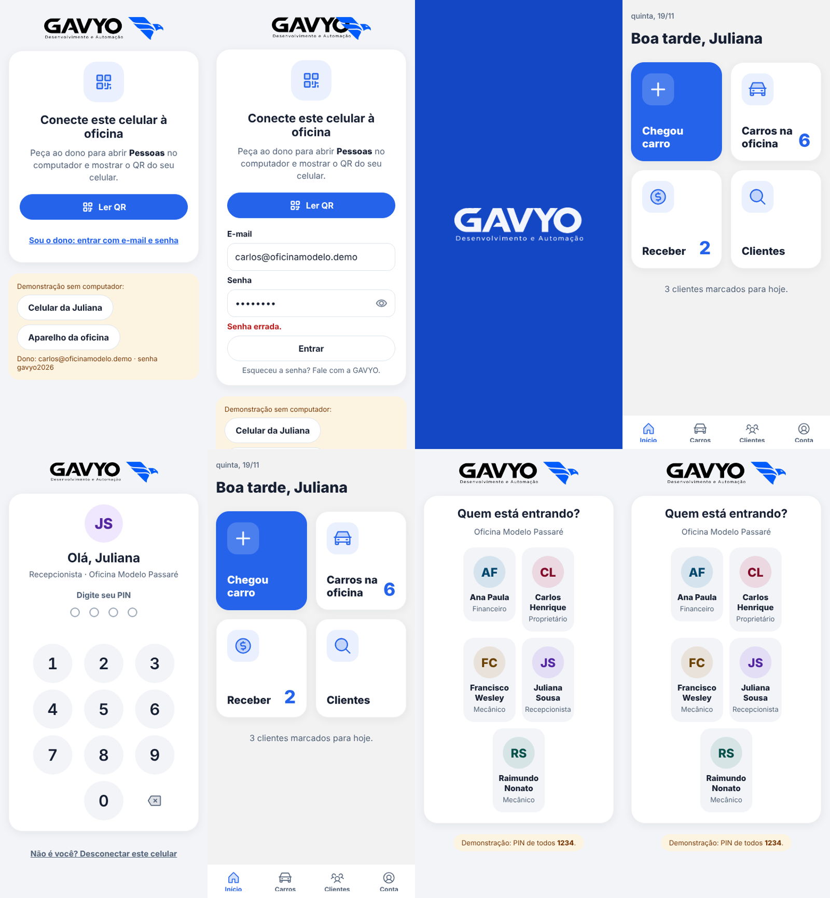
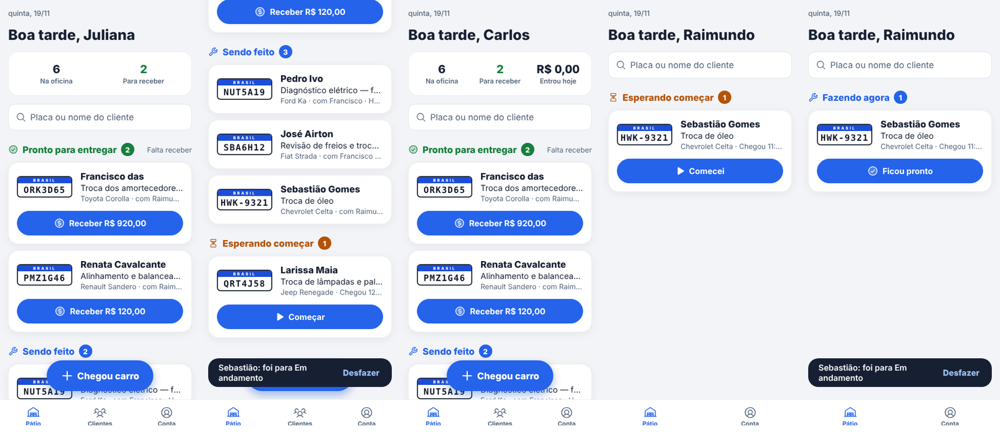

# App mobile GAVYO Auto — briefing para o agente

Documento com as decisões e os prompts do app. Por decisão de 18/11, o app é construído nesta mesma sessão; os prompts continuam valendo se outro agente assumir. Tem: as decisões já tomadas, a arquitetura, a direção visual, o **prompt principal** e os **prompts por etapa**, cada um com critério de pronto. Copie o prompt principal primeiro e depois uma etapa por vez.

---

## 1. Decisões já tomadas (não reabrir)

| Tema | Decisão |
|---|---|
| Tecnologia | **Expo (React Native) + TypeScript**, Expo Router, builds pela EAS. App de loja (Android primeiro, iPhone depois). |
| Público na v1 | **Mecânico e recepção.** Dono e financeiro continuam no computador (site). |
| Dados agora | **Demonstração local no aparelho** (mesmo seed e mesmas regras do site), com uma camada de dados trocável. |
| Dados depois (Fase 2) | **API HTTPS do próprio Next.js na Hostinger + MySQL** (Prisma, `prisma/schema.prisma`). O app **nunca** fala com o banco direto e nunca guarda senha de banco. |
| Regras de negócio | **As mesmas do site**: `src/domain`, `src/services`, `src/lib/format.ts`, `src/lib/masks.ts`, `src/lib/whatsapp.ts`, `src/demo/seed.ts`. Não reescrever regra no app. |
| Idioma e tom | Português do balcão, frases curtas, perguntas em tom de conversa (ver glossário). |

### Por que o app não acessa o MySQL direto

```
App Expo ──HTTPS + token──▶ API (Next.js, plano Node.js da Hostinger) ──▶ MySQL (Hostinger, 127.0.0.1)
Site     ──HTTPS + sessão──┘
```

- Senha do banco dentro do app = qualquer um extrai e lê os dados de todas as oficinas.
- A API monta o `ctx` (usuário + oficina) **no servidor**, a partir do login — nunca a partir de um `workshopId` enviado pelo app (decisão já registrada em `docs/ARQUITETURA.md`).
- Hospedagem: o site de demonstração atual é estático (`npm run build:hostinger`). Para a API é preciso **plano com Node.js** (Business/Cloud) ou **VPS**. O MySQL fica no mesmo servidor.

---

### Decisões da entrevista de 18/11 (grill-me)

| Tema | Decisão |
|---|---|
| Quem desenvolve | **Esta sessão** (não outro agente), etapa por etapa, com capturas. Teste no celular pelo **Expo Go**; aqui na nuvem o teste é pela versão web do Expo. |
| Visual | **Mistura**: navegação nativa (abas de baixo, voltar, pilha) com os nossos componentes (placa desenhada, cartões, crachá, carimbo, pílulas, Phosphor duotone). |
| Abas (recepção) | **Hoje · Serviços · Pessoas · Conta**; "Novo serviço" como botão grande no topo de Hoje e Serviços. |
| Mecânico | **Pode lançar peças** (busca e adiciona; estoque baixa sozinho). |
| Câmera na placa | **Depois**, em etapa própria. V1 digita a placa. |
| Ordem | **Primeiro o link de acompanhamento do cliente** no site; depois o app (E0). |

### Link de acompanhamento do dono do carro

- Abre **no navegador**, sem instalar e sem login, a partir do "Avisar no WhatsApp".
- Mostra a etapa (Aguardando → Em andamento → Pronto), o que está sendo feito, **peças com preço, mão de obra e total**, e um botão **Falar no WhatsApp** com a oficina. Sem aprovar orçamento e sem fotos por enquanto.
- **Sem servidor (Fase 1)**: o link leva um **retrato do momento** (dados do serviço no próprio link). Funciona no site estático da Hostinger; a cada etapa a oficina reenvia. Na Fase 2 vira link ao vivo.

## 2. Arquitetura sugerida no repositório

```
sistema-precos/
  src/                 ← site atual (Next.js). domain/services/lib são compartilhados
  mobile/              ← app Expo (novo)
    app/               ← Expo Router (telas)
    src/data/          ← camada de dados: DemoRepository (agora) / ApiRepository (Fase 2)
    src/ui/            ← componentes do app (placa, crachá, abas, pílulas…)
    metro.config.js    ← watchFolders: ['..'] para importar ../src/domain etc.
    tsconfig.json      ← paths: "@core/*" → "../src/*"
```

- Importar regras com `@core/services/orders`, `@core/domain/types`, `@core/lib/masks`… **sem copiar arquivos**.
- `src/demo/store.ts` usa `localStorage`: no app, criar um store equivalente com **MMKV** (ou AsyncStorage) chamando as mesmas funções `(db, ctx, input)` sobre uma cópia, como o `demoStore.mutate` faz (transação local).
- Se algum arquivo compartilhado precisar de API do navegador, **não editar para o app**: abrir uma tarefa para separar a parte de navegador.

---

## 3. Direção visual (o "estilo GAVYO")

Construída e aprovada no site entre as decisões 45 e 64 (`docs/DECISOES.md`). O app segue a mesma linguagem, adaptada ao toque:

- **Superfície branca, borda fina, sombra leve, cantos 18–22 px, botões em pílula** (como a barra de navegação do site). Nada de vidro/desfoque (decisão 52, pesava).
- **Cores**: as da oficina (`primary`, `secondary` vindas de `settings`) + etapas **fixas**: Aguardando âmbar `#b45309`, Em andamento azul `#2563eb`, Pronto verde `#15803d`. Cor nunca sozinha: sempre com texto.
- **Ícones**: **Phosphor, peso duotone** (`phosphor-react-native`). Ampulheta = Aguardando, chave inglesa = Em andamento, selo = Pronto. Não usar ícones genéricos de outra biblioteca.
- **Âncora visual**: a **placa desenhada** (faixa azul "BRASIL" + texto da placa em mono) aparece em todo carro.
- **Abas de etapa** como o controle segmentado do iPhone: trilho cinza, aba escolhida branca e elevada, número grande na cor da etapa.
- **Um botão principal por carro**: Começar → Marcar como pronto → Receber R$ X.
- **Cadastro com crachá** que se preenche ao digitar e **carimbo "Cadastro concluído"** com carimbador descendo (decisões 62–63). No app, somar **vibração** (Haptics) no toque do carimbo.
- **Tamanhos**: alvo mínimo 48 dp, texto base 16, títulos 20–24. Respeitar fonte grande do sistema (Dynamic Type / escala de fonte do Android).
- **Movimento**: curto (200–400 ms), com propósito (o carro anda de etapa, a linha voa para a aba, o carimbo). Respeitar "reduzir movimento" do sistema.
- **Formulários**: uma pergunta por vez quando há muitas (Novo serviço), escolhas em botões em vez de listas, opcionais em "Mais detalhes", máscaras de telefone/placa/dinheiro iguais às do site (`masks.ts`: "150" = R$ 150).
- **Proibido** (regras da Impeccable usadas no site): rótulo pequeno acima de título, cartão dentro de cartão, borda colorida grossa na lateral, emoji como ícone, texto cinza sobre cinza.

### Glossário (palavras que o app usa)
Serviço (não "OS") · Aguardando / Em andamento / Pronto · Começar · Marcar como pronto · Receber · Falta receber · Peças · Mão de obra · Quem vai fazer? · Chegou: abrir serviço · Pessoas · Cliente · Funcionário · Carro (não "veículo") · Placa.

---

## 4. Escopo da v1 (mecânico + recepção)

**Mecânico**
1. Entrar (demo: escolher "Mecânico").
2. **Seus carros** (tela inicial): Você está fazendo / Para você começar, cada carro com placa desenhada e um botão.
3. **Ficha do serviço**: o que fazer, peças (+ adicionar por busca), observações, caminho do serviço; botão Começar / Marcar como pronto.
4. **Foto do carro** (opcional na v1, desejável): tirar foto e anexar ao serviço (na demo, guardar local).

**Recepção**
1. **Hoje / pátio**: carros por etapa (Esperando começar → Sendo feito → Pronto, esperando o cliente) + quem chega hoje.
2. **Serviços** em abas (Aguardando · Em andamento · Pronto) com busca.
3. **Novo serviço passo a passo** (placa → carro → cliente → o que fazer → quem faz → conferir), com **câmera para ler a placa** (OCR) como atalho opcional; digitar sempre funciona.
4. **Receber** com a forma de pagamento ilustrada e troco.
5. **Avisar no WhatsApp** (abre o WhatsApp com a mensagem pronta, `whatsapp.ts`).
6. **Pessoas**: buscar cliente por nome/telefone/placa; novo cliente com crachá + carimbo.

**Fora da v1**: financeiro, estoque completo, relatórios, configurações, permissões detalhadas (continuam no site).

---

## 5. Prompt principal (colar primeiro)

```text
Você vai construir o app mobile do GAVYO Auto, sistema de oficina mecânica para
pessoas sem experiência com sistemas (recepção e mecânicos). O site já existe neste
repositório (Next.js 16, pasta src/). Leia antes de qualquer código:
docs/APP-MOBILE.md (este briefing), docs/DECISOES.md (decisões 45 a 64), docs/INTERFACE.md,
docs/ARQUITETURA.md e AGENTS.md.

Regras fixas:
- Expo (React Native) + TypeScript + Expo Router, na pasta mobile/. Android primeiro.
- NÃO reescreva regras de negócio: importe de ../src/domain, ../src/services,
  ../src/lib/format.ts, ../src/lib/masks.ts, ../src/lib/whatsapp.ts e ../src/demo/seed.ts
  (alias @core/*, metro watchFolders). Se algo compartilhado depender do navegador,
  pare e me avise em vez de editar.
- Dados: camada Repository. Agora DemoRepository (seed + MMKV, mutação sobre cópia como
  demoStore.mutate). Depois ApiRepository (HTTPS + token). Telas nunca chamam o storage direto.
- O app nunca acessa banco de dados direto nem guarda credenciais de banco.
- Público v1: mecânico e recepção (escopo na seção 4 do briefing).
- Visual: seção 3 do briefing (estilo GAVYO): Phosphor duotone, placa desenhada, abas
  estilo iPhone, um botão principal por carro, pílulas, sombras leves, cores de etapa fixas,
  português de balcão (glossário). Alvos ≥ 48 dp, fonte do sistema respeitada,
  "reduzir movimento" respeitado, leitor de tela (accessibilityLabel/Role) em tudo.
- Antes de cada entrega: npx tsc --noEmit, lint, testes (os do site continuam passando:
  npm test na raiz), rodar no emulador Android e mandar capturas de tela. Um commit por
  etapa, mensagem em português. Pergunte antes de decisões visuais novas.
- Trabalhe uma etapa por vez (prompts E0 a E8 do briefing) e mostre o resultado antes de seguir.
```

---

## 6. Prompts por etapa

Cada etapa termina com: capturas no emulador (tela pequena 360 dp e grande 412 dp), checagem com TalkBack na tela principal da etapa, commit e um resumo curto.

**E0 — Base do projeto**
```text
Etapa E0: crie mobile/ com Expo (SDK estável mais recente), TypeScript estrito, Expo Router,
alias @core/* para ../src/* (tsconfig + metro watchFolders), phosphor-react-native,
react-native-mmkv, expo-haptics. Prove o compartilhamento: uma tela que importa
formatPhone e maskMoney de @core/lib e buildSeed de @core/demo/seed e mostra 3 clientes do seed.
Crie o tema (tokens: cores da oficina vindas de settings, cores de etapa fixas, raios,
sombras, tipografia 16/20/24) e os componentes base: Botão pílula, Placa desenhada,
Avatar (foto ou iniciais), Chip, Abas segmentadas. Pronto quando: roda no Android,
tsc e lint limpos, captura da tela de prova.
```

**E1 — Dados de demonstração e login**
```text
Etapa E1: implemente DemoRepository com o seed do site e MMKV, executando os serviços
de @core/services sobre uma cópia do banco e só gravando se não houver erro (igual
src/demo/store.ts). Interface Repository pensada para a futura ApiRepository (mesmos
métodos, assíncronos). Tela de entrada (decisão 76): o celular é conectado pelo QR que o dono mostra em Pessoas (pessoal ou do aparelho da oficina); depois abre com digital ou PIN; o dono tem e-mail e senha da GAVYO como reserva
(Recepcionista ou Mecânico), como em src/app/login. "Restaurar demonstração" em Minha conta.
Pronto quando: trocar de usuário e oficina funciona e os dados persistem ao fechar o app.
```

**E2 — Mecânico: Seus carros**
```text
Etapa E2: tela inicial do mecânico igual à "Seus carros, Nome" do site
(src/features/dashboard/yard.tsx, MechanicYard): grupos "Você está fazendo" e
"Para você começar", cartão com placa desenhada, carro · cliente, serviço, há quanto tempo,
e UM botão (Começar / Marcar como pronto) usando changeOrderStatus com as mesmas permissões.
Ao mudar de etapa: o cartão anima para o novo grupo + vibração leve + aviso com "Desfazer".
Puxar para atualizar. Sem dinheiro nenhum para o mecânico.
```

**E3 — Ficha do serviço**
```text
Etapa E3: ficha do serviço em tela cheia (no celular, uma coluna), baseada em
src/features/orders/order-details-dialog.tsx (decisão 60): placa + carro + cliente,
caminho do serviço (Aguardando → Em andamento → Pronto → Pago) tocável, O que fazer,
Peças (lista; "Adicionar peça" com busca como o PartsEditor do site), O que aconteceu
recolhido, e o botão principal fixo no rodapé. Recepção vê Quanto custa e as ações
(Ligar, Avisar no WhatsApp, Mandar orçamento). Mecânico não vê valores.
```

**E4 — Recepção: Hoje e Serviços**
```text
Etapa E4: tela Hoje da recepção (pátio, decisão 58: Esperando começar → Sendo feito →
Pronto, esperando o cliente; quem chega hoje com "Chegou: abrir serviço") e a tela
Serviços em abas (decisão 59: Aguardando · Em andamento · Pronto, busca, Pronto dividido
em Falta receber / Pagos). Navegação inferior com no máximo 4 itens: Hoje, Serviços,
Pessoas, Conta. Paginação/rolagem infinita a partir de 20 itens.
```

**E5 — Novo serviço passo a passo + câmera na placa**
```text
Etapa E5: Novo serviço em passos (decisão 56): placa (com placa desenhada grande) →
carro (se a placa já existe: "É o Fiat Uno da Maria?") → cliente → o que fazer (sugestões
em botões) → quem faz (mecânicos com "Livre agora / N carros") → conferir e Abrir serviço.
Usa createOrder de @core. Atalho: botão "Ler placa com a câmera" (expo-camera + OCR
on-device; se não reconhecer, segue digitando). Máscaras de @core/lib/masks.
Ao abrir: o cartão "nasce" na lista com destaque.
```

**E6 — Receber e WhatsApp**
```text
Etapa E6: Receber (decisão 50): escolher forma (Dinheiro, PIX, Cartão, Transferência)
em blocos ilustrados, troco para dinheiro, botão "Recebi R$ X"; comemoração curta +
vibração. Sem campos de cartão e sem QR code. "Avisar no WhatsApp" abre o app do
WhatsApp com a mensagem de @core/lib/whatsapp (Linking).
```

**E7 — Pessoas com crachá e carimbo**
```text
Etapa E7: Pessoas (decisão 62) com abas Clientes · Carros (funcionários ficam no site),
busca por nome/telefone/placa, ficha do cliente com carros e serviços. Novo cliente com
o crachá que se preenche ao digitar e, ao salvar, o carimbador descendo e carimbando
"Cadastro concluído" (decisão 63: descida direta acelerando, achatada no toque, marca
aparece no toque, ~0,9 s) com vibração no toque. Reanimated; com "reduzir movimento",
a marca aparece parada.
```

**E8 — Acabamento, acessibilidade e build**
```text
Etapa E8: revise todas as telas com TalkBack e fonte grande (200%), modo escuro do sistema
(definir tokens escuros), alvos ≥ 48 dp, estados vazios e de erro com o próximo passo,
sem internet (aviso e botões que gravam desativados, como no site). Teste de fluxo com
Maestro para as 4 tarefas do site (abrir serviço, mudar etapa, receber, achar cliente).
Configure EAS (perfil preview para APK interno). Entregue o link do APK.
```

**E9 — (Fase 2) Ligar na API**
```text
Etapa E9 (só quando a API existir): implemente ApiRepository (fetch HTTPS para
https://<dominio>/api, token guardado no SecureStore, renovação de sessão). Nenhuma tela
muda. O servidor monta ctx (usuário + oficina) a partir do token. Fila local para ações
feitas sem internet só se for decidido antes (por padrão: bloquear como no site).
```

---

## 7. O que o dono precisa providenciar

- Conta **Expo** (EAS) para gerar o APK/AAB.
- Conta **Google Play Console** (taxa única) para publicar no Android; **Apple Developer** (anual) quando for para iPhone.
- Para a Fase 2: plano Hostinger **com Node.js** (ou VPS), banco **MySQL** criado no painel e um subdomínio para a API (ex.: `api.gavyo.me` ou a mesma URL do sistema).

## 8. Perguntas ainda abertas (decidir com o dono antes da etapa indicada)

- E3: mecânico pode lançar peças ou só ver? (No site, cargo Mecânico tem `os.parts`.)
- E5: vale pagar por OCR em nuvem se o on-device não for bom o bastante?
- E8: publicar na Play Store já na v1 ou só APK interno para teste?
- E9: o app precisa funcionar sem internet (fila) ou pode bloquear como o site?

## Entrada do app (decisão 76)



- **Sem oficina:** "Conecte este celular à oficina" → **Ler QR** (câmera com moldura e linha de leitura). Reserva do dono: e-mail e senha da GAVYO.
- **Celular da pessoa (QR pessoal):** abre pedindo a **digital/rosto**; sem isso, o **PIN**. "Não é você? Desconectar este celular".
- **Aparelho da oficina (QR do balcão):** "Quem está entrando?" + PIN; quem entrou por último já vem aberto.
- Ao entrar: a águia bate as asas e o **rasante do gavião** leva ao app (Reanimated, na thread de animação).
- O jeito como o celular está ligado fica guardado no aparelho (AsyncStorage); fase 2: chave do servidor no cofre do aparelho.
- Conta: **Sair** (volta à digital/PIN) e **Desconectar este celular/aparelho**.

## Pátio por função (decisão 76)



- Abas: **Pátio · Clientes · Conta** (mecânico: Pátio · Conta). Saíram os 4 botões grandes e a aba Carros: era um "menu do menu".
- Pátio = carros separados por situação: **Pronto para entregar** (botão "Receber R$ …"), **Sendo feito**, **Esperando começar**; busca por placa ou cliente no topo.
- Cartão: placa, cliente, o que fazer, carro · com quem · desde quando, e **um botão da próxima ação** (toque; aviso com Desfazer).
- **Mecânico:** só os carros dele, "Comecei" / "Ficou pronto". **Recepção:** resumo (na oficina, para receber) e **"Chegou carro"** fixo embaixo. **Dono:** o mesmo, mais **"Entrou hoje"**.
- Animações: cartões entram em cascata curta e se reorganizam quando mudam de seção (240 ms); o botão "Chegou carro" sobe ao abrir.
