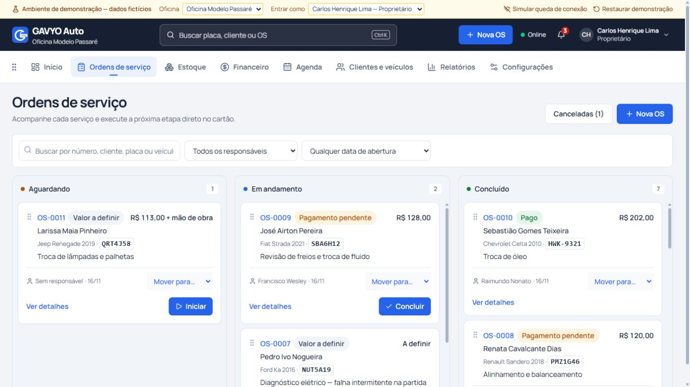
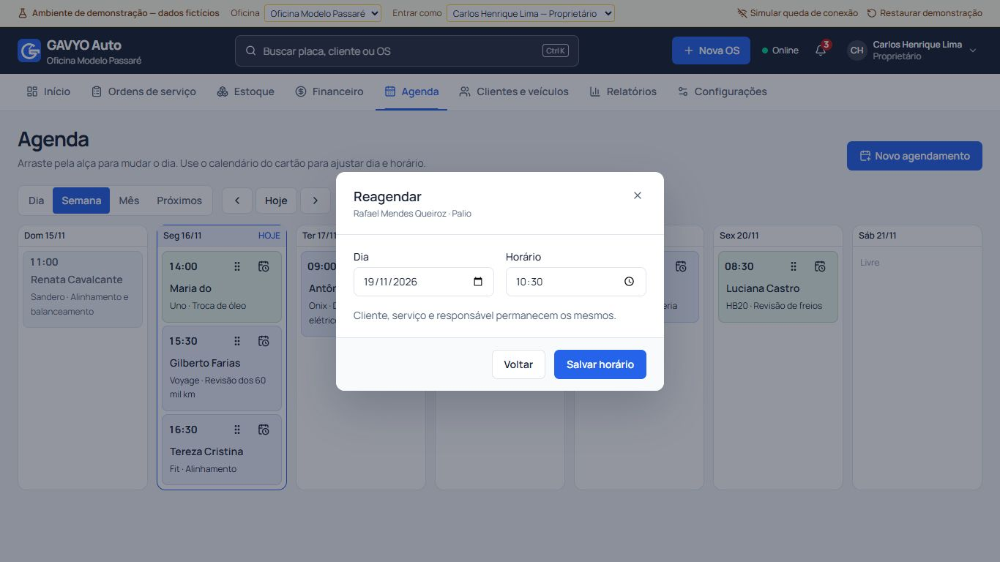

# Estado atual e continuidade — 17/11/2026

## Resumo para quem chega agora

**Projeto:** GAVYO Auto (repositório `sistema-precos`), branch `feat/visual-oficina` (PR #1). Demonstração de frontend com dados fictícios no navegador (sem backend, autenticação real ou cobrança). Enviado ao GitHub; não é deploy nem merge na `main`.

**Direção:** uso **sem treino** para recepção e dono (plano concluído, passos 1–6) + estilo **sistema operacional** assumido (decisão 49): o caminho principal é sempre um botão escrito; gestos, atalhos e janelas são extras com alternativa.

**Como usar cada tela:** [INTERFACE.md](INTERFACE.md). **Animações e como criar novas:** [ANIMACOES.md](ANIMACOES.md). **Por quê:** [DECISOES.md](DECISOES.md) (37–50 são desta rodada).

### Entregas desta rodada (17/11)

| Commit | O quê |
|---|---|
| `0951e26` | Passo 2 — linguagem de balcão (Serviço, Pronto, Começar, Falta pagar…) em telas, erros, PDF, Excel e WhatsApp |
| `88bfff7` | Passo 3 — busca aberta, abas sempre com nome, botões escritos, Ver serviço completo |
| `2fb227c`, `a6b6f38` | Passo 4 — telas vazias com próximo passo; tour guiado com balões, setas e ilustrações |
| `d6550a3` | Passo 5 — tela **Hoje**: quem chega hoje e quem falta pagar |
| `d97ee9f` | Passo 6 — validação das 4 tarefas + correções (campos que faltam, alvos de toque) |
| `745d2e1` | Menu na lateral que empurra a página (logo voa e estoura; abre com o mouse por cima) |
| `e1d977e` | Recepção pode receber pagamento |
| `2a38429` | Animações: cartão anda de coluna, receber com comemoração, cartão vira janela, pílula da aba, cor da oficina varrendo |
| `da6f408` | Quadro de Serviços com respiro (uma rolagem só) |
| `e86cb17` | Janela Receber ilustrada (cartão, cédulas, PIX, comprovante) e troco |
| `5411562` | Publicação estática na Hostinger (`npm run build:hostinger`) — publicada em demo.gavyo.me |
| (18/11) | Serviço novo nasce no quadro, números que contam, **modo TV da parede** (`/tv`) |
| `294afa4` | Auditoria leiga ([AUDITORIA-LEIGO-20261118.md](AUDITORIA-LEIGO-20261118.md)) item 1 — **Novo serviço passo a passo** |
| `64badb4` | Item 2 — **formulários com escolhas em botões**, dia/hora por atalhos, opcionais em "Mais detalhes" (decisão 57) |
| `52c95ef` | Item 3 — **Hoje vira o pátio**: carros por etapa com placa desenhada e um botão; mecânico só vê os carros dele (decisão 58) |
| (18/11) | **Serviços: uma tela por etapa** (estilo da navegação, abas estilo iPhone, ícones Phosphor duotone) — abas Aguardando / Em andamento / Pronto no lugar do quadro de colunas (decisão 59) |
| (18/11) | **Ficha do serviço** em duas colunas com caminho do serviço clicável; clicar no carro abre a ficha, sem painel lateral (decisão 60) |
| (18/11) | Correção: cabeçalho tremendo em página curta (decisão 61) |
| (18/11) | **Pessoas** (clientes, funcionários e carros) com crachá que se preenche e carimbo "Cadastro concluído"; foto do funcionário (decisão 62) |
| (18/11) | Carimbador animado (63); **máscaras** em telefone, placa, dinheiro, e-mail e km, e **paginação** nas listas longas (64) |
| (18/11) | Briefing do **app mobile** para outro agente: [APP-MOBILE.md](APP-MOBILE.md) (decisão 65) |
| (19/11) | App simplificado (botões grandes), animações, clientes com crachá e carimbo (decisões 68–69); **entrada nova com nome + PIN** no site (decisão 70) e rasante do gavião ao entrar (decisão 72); entrada própria para computador com painel azul (decisão 73); conectar o aparelho com o e-mail do dono e correções do fluxo de entrada (decisão 74) |
| (18/11) | App mobile **E0**: base em `mobile/` (Expo SDK 58), regras do site compartilhadas, tema e componentes base (decisão 67) |
| (18/11) | App: **primeira versão navegável das telas** (Hoje/pátio, Serviços em abas, ficha, Receber, Novo serviço passo a passo, Pessoas, Conta, Seus carros do mecânico) com dados de demonstração em memória — para discutir a direção visual |

### Validação vigente

`npm run typecheck`, `npm run lint`, `npm test` (48 testes) e `npm run build` passam. Simulação das 4 tarefas sem treino (1366 e 390 px; Proprietário e Recepcionista) concluída; axe-core sem violações em Hoje, Serviços, detalhes, Receber, menu lateral, Novo serviço e todos os formulários (agendamento, peça, entrada/saída, despesa, entrada, peças do serviço, editar serviço, funcionário — 1366 e 390 px); conferidos Mecânico, segunda oficina, sem internet e movimento reduzido. Script: [validacao/simular-sem-treino.js](validacao/simular-sem-treino.js).

### Pendente / próximos

- **Auditoria leiga, itens 4–6:** Estoque em cartões (Clientes já virou Pessoas); Financeiro em frase; Agenda no Dia, busca única, editar no lugar, Configurações.

- **Teste com uma pessoa real** (roteiro em [validacao/SEM-TREINO-20261117.md](validacao/SEM-TREINO-20261117.md)).
- **Escolhidos pelo usuário, ainda não feitos:** texto 12 → 14 px.
- **Sugeridos, não escolhidos:** texto de 12 px → 14 px (item 14 da auditoria); peça voa para o serviço; agendamento voa de dia; catálogo de serviços para o cliente (página pública + link no WhatsApp).
- ✅ Selo "1 Issue" do Next no modo de desenvolvimento: era a extensão da BRy (assinatura digital) colocando atributos `data-bry-content-script-*` no `<html>`; resolvido com `suppressHydrationWarning` em `<html>` e `<body>` (vale só para os atributos desses dois elementos).

### Onde continuar no código

| Área | Arquivos |
|---|---|
| Cabeçalho, layout, Minha conta, demo | `src/components/layout/app-shell.tsx` |
| Menu (topo, flutuante, lateral, pílula) | `movable-navigation.tsx`, `personal-navigation.tsx`, `side-navigation.tsx`, `nav-pill.tsx` |
| Tela Hoje | `src/features/dashboard/today-panel.tsx`, `dashboard-page.tsx` |
| Quadro, cartão, painel, janela | `src/features/orders/orders-page.tsx`, `order-peek.tsx`, `order-details-dialog.tsx`, `quick-order-action.tsx`, `move-order.ts` |
| Receber | `src/features/orders/payment-stage.tsx`, `order-dialogs.tsx` |
| Tour | `src/components/ui/guided-tour.tsx` |
| Animações | `src/lib/view-transition.ts`, `src/lib/celebrate.ts`, `src/app/globals.css` |
| Termos | `src/domain/labels.ts`, `src/lib/format.ts` (`formatOrderNumber` → "Serviço nº 11"), `src/services/*` (mensagens) |

---

## Histórico detalhado da rodada de 17/11

Plano e auditoria: [PLANO-SEM-TREINO.md](PLANO-SEM-TREINO.md). Um commit por passo.

- **Passo 2 — Linguagem (feito):** "OS" virou **Serviço** em telas, mensagens de erro, PDF, Excel e WhatsApp; número exibido "Serviço nº 11" (`formatOrderNumber`). Menu "Serviços", botão "Novo serviço". Etapa "Concluído" → **Pronto**; botões **Começar / Marcar como pronto / Receber**. "Pagamento pendente" → **Falta pagar**. Estoque: botão **Entrada / Saída**, aba **Histórico de peças**, coluna **Ficou com**, opções "Chegou peça / Saiu peça / Contei o estoque". Relatórios: **Dinheiro que entrou e saiu**, **Peças em estoque**, **Histórico de peças**. Financeiro: **Sobrou no caixa**, **Entrada sem serviço**. Agenda: **Chegou: abrir serviço**. Offline: "Sem internet" com o que fica bloqueado em palavras simples. Busca: "Buscar placa ou nome do cliente".
  - Dados já salvos no navegador mantêm textos antigos de histórico ("OS aberta", "Status alterado para Concluído"); a atividade recente do Início reconhece os dois formatos. "Restaurar demonstração" recria tudo com os textos novos.
  - Chaves internas (`os.view`, rota `/ordens`, atalho G+O) não mudaram.
- **Passo 3 — Caminho principal visível (feito):** cabeçalho em duas linhas — oficina · **campo de busca sempre aberto** ("Buscar placa ou nome do cliente", Ctrl+K continua) · Novo serviço, Acessibilidade, **Avisos** e **Minha conta** com nome escrito; abaixo, as abas **sempre com nome** (todas em ≥1100 px; 6 + "Mais" no tablet; 4 + "Mais" no celular, com ícone e nome embaixo). Painel lateral do serviço: botão **"Ver serviço completo"** e botão da próxima etapa em tamanho normal. Detalhes do serviço: botão da próxima etapa (Começar / Marcar como pronto) ao lado de **Receber**; o seletor virou "Mudar etapa". "Registrar pagamento" virou **Receber** no Financeiro e no Início. Celular: bandeja compacta à direita para não cobrir os cartões.
- **Passo 4 — Telas que ensinam (feito):** estados vazios dizem o próximo passo e, quando faz sentido, trazem o botão (ex.: busca sem resultado no quadro → "Limpar busca" e "Novo serviço"; agenda vazia → "Novo agendamento"; Início com filtro vazio → "Ver todos em aberto"). **Tour guiado de primeira vez** (`src/components/ui/guided-tour.tsx`): balões em sequência ("1 de 5") que escurecem a tela, recortam o elemento e apontam para ele com seta animada, com pequenas ilustrações animadas (busca sendo digitada, Começar → Marcar como pronto → Receber, cartão sendo arrastado, toque no botão). Quadro de Serviços: busca, botão do próximo passo, cartão, arrastar (opcional) e Novo serviço. Painel do serviço: lançar peça (+), mão de obra digitável, próximo passo e Ver serviço completo. Pular/✕/Esc encerram; ← → navegam; aparece uma vez por usuário e oficina; **Minha conta › Ver as dicas de novo** reapresenta. Movimento reduzido deixa tudo parado. Mão de obra no painel: **clique e digite** (arrastar continua). Bandeja vazia explica para que serve ao clicar. Pagamento: janela "Receber", pergunta "Como o cliente pagou?" e botão "Recebi R$ …". "Personalizar painel" saiu da tela e virou **Minha conta › Organizar tela inicial** (`/inicio?organizar=1`; botão "Terminar"). Barra da demonstração: "Simular queda" e "Restaurar" recolhidos em **Opções da demonstração**.
- **Passo 5 — Tela "Hoje" (feito):** o Início virou **Hoje** (aba e título; rota `/inicio` mantida) e é a primeira tela após entrar. No topo, dois blocos lado a lado (empilhados em telas menores): **Quem chega hoje** — horário grande, nome, carro/placa, o que foi marcado, selo "Próximo"/"Atrasado"/"Já chegou" e o botão **Chegou: abrir serviço** (abre o Novo serviço já preenchido pelo agendamento; depois vira "Ver Serviço nº X"); e **Quem falta pagar** — carros prontos e não pagos (e entradas a receber, para quem vê o financeiro), com valor, "Pronto ontem/desde" e botão **Receber**. Recepcionista via a lista sem o botão (aviso "Quem recebe: dono ou financeiro"); desde `e1d977e` o cargo padrão recebe (decisão 46). Abaixo, "Na oficina agora" com o painel de antes; o bloco "Agenda de hoje" e a linha "Agendamentos do dia / Peças com estoque baixo" saíram (repetiam o novo topo). Tour de 3 passos (Chegou, Receber, aba Serviços). Mecânico continua com "Meus serviços". Só reorganiza dados existentes: nenhuma regra nova.
- **Passo 6 — Validação (feito):** simulação de pessoa sem experiência nas 4 tarefas (abrir serviço, mudar etapa, receber, achar cliente), só pelo texto visível, + axe-core. Todas concluídas em 1366 e 390 px (Proprietário) e como Recepcionista (exceto receber, por permissão). Corrigidos: formulário de Novo serviço mostra de uma vez os campos que faltam (campo "O que o cliente pediu"), alça de arrastar com 24 px, área de clique do nome em "Quem falta pagar". Relatório, roteiro para teste com pessoa real e script em [validacao/SEM-TREINO-20261117.md](validacao/SEM-TREINO-20261117.md).
- **Menu na lateral (pedido do usuário, depois do passo 6):** o menu do topo pode virar uma barra fixa à esquerda que **empurra a página**. Três caminhos: arrastar a alça do menu até a borda esquerda ("Solte para fixar na lateral"), **Minha conta › Menu na lateral**, ou o botão "Fixar na lateral" na janela de posição. Na troca, a logo voa do topo para a barra e **estoura** ao chegar (anel + partículas), a barra entra deslizando, os itens aparecem em cascata e o conteúdo desliza para o lado (View Transitions API; sem suporte ou com movimento reduzido, troca direto). A barra fica **recolhida** (ícone com nome curto embaixo, 108 px) e **abre sozinha com o mouse por cima** (240 px, por cima do conteúdo, sem empurrar de novo); fecha ao tirar o mouse. Foco do teclado também abre. **Menu no topo** no rodapé da barra; arrastar a alça da barra até o topo também volta. Vale a partir de 1100 px; abaixo, menu do topo/barra de baixo. Salvo por usuário e oficina. Arquivo: `src/components/layout/side-navigation.tsx`.
- **Animações que mostram o que aconteceu (pedido do usuário):** (1) **cartão anda de coluna** ao clicar Começar/Marcar como pronto (ou mover pelo ⋯): voa até a nova coluna, assenta e brilha; os outros cartões se reacomodam. No arraste não anima (o cartão já está na mão). (2) **Receber com comemoração**: check verde que se desenha, moedas que estouram, o valor "+ R$ …" voa até a aba Financeiro (ou Hoje) e ela dá um pulinho; a linha paga sai de "Quem falta pagar" com brilho verde e as outras sobem. (3) **Cartão vira a janela do serviço** (e encolhe de volta ao fechar); de outros lugares, a janela cresce a partir do botão clicado. (4) **Pílula da aba ativa desliza** até a nova aba (topo, barra de baixo e lateral) e **troca de oficina** com a cor nova varrendo a tela em círculo a partir da logo. Base comum: `src/lib/view-transition.ts` (`withTransition`) e `src/lib/celebrate.ts`; nomes de transição só existem durante a troca (`html[data-vt]`). Movimento reduzido ou navegador sem suporte: muda direto, sem animação.
  - Corrigido junto: o tour de primeira vez não aparece mais por baixo de uma janela aberta (esperava e "roubava" o Esc da janela).
- **Janela Receber ilustrada (pedido do usuário):** em cima, um desenho da forma escolhida com o valor — **cartão** genérico na cor da oficina (gira ao entrar, chip, brilho, nome do cliente e da oficina), **cédulas** em leque, **celular** com "Pix recebido" e **comprovante** de transferência que "sai da impressora". Embaixo, as 4 formas como botões grandes com ícone e dica (rádios de verdade: setas do teclado trocam). Em **Dinheiro**, "Quanto o cliente entregou?" com atalhos (Exato, notas redondas) e **troco** na hora; valor menor que o total bloqueia "Recebi" ("Faltam R$ …"). Não pede dados de cartão, não usa marcas reais e não mostra QR code. Também em "Receber" de entradas sem serviço e nos formulários do Financeiro (só os botões). Arquivo: `src/features/orders/payment-stage.tsx`.
- **Quadro de Serviços com respiro:** colunas sem rolagem própria (só a página rola), mais espaço entre cartões e folga no fim da página.


---

## Histórico — rodadas até 16/11 (termos antigos: "OS", "Início", "Concluir"; mantido como registro)

### Atualização local de acessibilidade

A branch agora inclui preferências pessoais de texto, contraste, espaçamento, movimento e leitura ampliada, além de melhorias de foco e alternativas ao arraste. Uso, referências e validação em [ACESSIBILIDADE.md](ACESSIBILIDADE.md). A entrega e as verificações abaixo registram a rodada anterior; já enviada ao GitHub.

### Entrega

Projeto: GAVYO Auto, no repositório sistema-precos. Trabalho na branch feat/visual-oficina, PR #1. As alterações de código desta rodada terminam em f43be88; este documento e os índices foram adicionados depois. O envio ao GitHub não representa deploy ou merge na main.

Continua sendo uma demonstração com dados fictícios em localStorage, sem backend, autenticação real, sincronização ou integração de cobrança.

### Comportamento em 16/11

- Início: quatro indicadores sólidos, cores funcionais, filtros e próxima ação junto à OS.
- Busca global por placa, cliente ou número, com Ctrl/Cmd+K; Iniciar, Concluir e Receber conforme acesso e estado.
- Agenda: arraste pela alça para mudar o dia, mantendo horário, e botão de calendário para editar rapidamente dia/horário. Atendidos, cancelados e convertidos em OS permanecem protegidos. Conflitos de mecânico/horário usam a validação existente.
- Navegação: arraste a barra inteira pela alça. Ao aproximar do topo, aparece a indicação de encaixe; soltar restaura a faixa horizontal com animação de 220 ms. Não há menu de configuração. Dois cliques na alça ou Home também restauram o topo; setas movem por teclado.
- A posição flutuante é salva por usuário e oficina neste navegador. A ordem antiga dos atalhos é respeitada, mas a interface de reordenação foi retirada na simplificação pedida pelo cliente.
- Estoque/clientes: ordenação por colunas. Financeiro: semana/dia. Temas por oficina, permissões e estados offline preservados.

Os percursos prioritários são localizar OS, mudar status e receber pagamento. Não reduzir textos operacionais ou introduzir animações demoradas. Manter navegação simples e linguagem de oficina.

### Complemento: interface mais interativa

Commits após 548d111 (inspiração: praticidade do macOS):

- **Desfazer:** após reagendar (arraste ou edição rápida) ou mudar a etapa da OS (quadro, lista, busca), o aviso traz "Desfazer"; Ctrl/⌘+Z faz o mesmo enquanto o aviso estiver visível. Só é oferecido quando a regra permite voltar.
- **Busca Ctrl+K com comandos:** além das OS, mostra comandos (Nova OS, Novo agendamento, Ir para módulo), clientes e peças quando há texto. Clientes e peças abrem o módulo já filtrado (`?q=`).
- **Atalhos:** `N` nova OS; `G` + letra abre módulo (I Início, O Ordens, E Estoque, F Financeiro, A Agenda, C Clientes, R Relatórios, S Configurações). Não agem em campos de texto nem com modal aberto.
- **Painel do Início personalizável:** botão "Personalizar painel" permite arrastar, redimensionar (canto inferior direito) e ocultar blocos; "Restaurar padrão" volta ao layout original. Botões de cada bloco fazem o mesmo pelo teclado. Também no painel do financeiro. Salvo por usuário e oficina neste navegador.
- **Tabelas ajustáveis:** Estoque, Clientes e Veículos permitem ordenar, ajustar largura pela borda do cabeçalho e ocultar colunas (menu "Colunas"), com "Restaurar colunas".

Arquivos: `src/components/layout/order-search.tsx`, `src/components/layout/global-shortcuts.tsx`, `src/components/ui/widget-grid.tsx`, `src/components/ui/data-table.tsx`, `src/components/ui/toast.tsx`, `src/features/orders/move-order.ts`, `src/features/schedule/interactive-agenda.tsx`, `src/lib/prefs.ts`. Novas dependências: `react-grid-layout`, `@tanstack/react-table`.

Validação: typecheck, lint, 32 testes e build aprovados. No navegador (1366 × 768 e 820 px): busca com comandos, atalhos, desfazer na agenda e no quadro (inclusive Ctrl+Z), painel arrastado/persistido, tabelas com largura e ordenação persistidas, offline bloqueando arraste e atalhos de escrita, cargo Mecânico sem personalização e segunda oficina com suas cores. Não alterados: `src/services`, `src/domain`, `src/demo`.

### Revisão de uso (densidade e largura)

- **Ordens:** cartão compacto; mover de etapa e abrir detalhes ficam no menu "⋯"; a próxima ação (Iniciar/Concluir/Receber) continua visível.
- **Estoque:** "Movimentar" visível; "Ver histórico" e "Editar peça" no "⋯".
- **Tabelas:** ocupam a largura do cartão em Estoque, Financeiro, Clientes e Relatórios.
- **Relatórios:** tipos em faixa horizontal; tabela de OS cabe inteira em 1366 px.

### Ordens: painel lateral, peças e responsáveis por arrasto

- Clique no cartão (ou Espaço) abre o resumo da OS ao lado; ↑ ↓ trocam de OS; Esc fecha; a borda esquerda ajusta a largura.
- No painel: arraste peças do estoque para "Peças utilizadas" (ou use +); − e a lixeira devolvem ao estoque. Desfazer disponível.
- Faixa de responsáveis acima do quadro: clique filtra; solte uma OS para atribuir. Campo "Responsável" no painel faz o mesmo sem arrasto.
- Offline ou sem permissão, os alvos e botões de alteração ficam desativados.

### Ordens: seleção, bandeja, ajuste por arrasto e mini janela

- **Seleção múltipla:** Ctrl/⌘/Shift+clique, X ou a caixa do cartão; arraste uma para levar todas; barra com Mover/Atribuir/Bandeja; Esc limpa.
- **Bandeja:** canto inferior esquerdo, em todas as telas; arraste OS ou peças para guardar e depois para onde precisar; "Guardar na bandeja" também no ⋯ das OS e das peças.
- **Arrastar para ajustar:** quantidade e mão de obra no painel da OS (Shift = passo maior; teclado ← → e Enter).
- **Mini janela:** botão ao lado do fechar no painel da OS (Chrome/Edge); fica por cima de outros programas.

### Cabeçalho "ilha flutuante"

- Três cápsulas presas no topo: oficina · menu · busca/Nova OS/acessibilidade/avisos/conta. Encolhem ao rolar.
- Busca: ícone de lupa que se expande (clique ou Ctrl/⌘+K). Menu com 6 módulos e "Mais"; a tela atual nunca fica escondida no "Mais".
- Aba ativa e avatar na cor secundária da oficina (Configurações › Cor secundária).
- A cápsula do menu ainda pode ser arrastada para flutuar e encaixada de volta no topo.
- Celular: menu vira barra flutuante embaixo; só o logo da oficina aparece no topo.

### Executar

Requisitos e instalação estão no README. Na demo, não é necessário arquivo .env com credenciais.

```powershell
npm ci
npm run dev
```

Para servir uma compilação, execute npm run build e depois npm run start. A prévia local desta entrega foi servida na porta 3017; essa porta não é uma URL pública.

### Validação realizada (16/11)

npm run typecheck, npm run lint, npm test (32 testes) e npm run build passaram na última alteração de código. Build gerou 14 páginas estáticas. Alterações posteriores desta entrega são documentação e capturas.

Conferidos no navegador: busca, próxima etapa, recebimento fictício, offline, cargos, segunda oficina, ordenação, gráfico e agenda. Na agenda, Rafael foi movido de quarta para quinta e depois devolvido ao dia/horário original por edição rápida. Na navegação, foram exercitados arraste livre, persistência, troca de orientação na versão anterior e, na versão final, arraste de retorno ao topo e persistência do encaixe após reload.

A revisão independente do redesenho cobriu os ajustes de legibilidade e pagamento; não constitui aprovação independente dos complementos posteriores de agenda/navbar.

Limites: não houve bateria integral em Safari/Firefox, leitor de tela ou emulação de movimento reduzido. A preferência de movimento foi revisada no código. Os testes automatizados existentes cobrem regras de negócio, não regressão visual. A agenda não modela duração/capacidade; não inventar uma grade horária para representar esses dados.

### Onde continuar (16/11)

- docs/NAVEGACAO.md: comportamento final da barra, gestos e persistência. Prevalece sobre as descrições antigas de navegação do DESIGN.md.
- docs/REVISAO-VISUAL.md: diagnóstico, referências, percursos e histórico de validação.
- PRODUCT.md e DESIGN.md: contexto e identidade visual; a seção de navegação do DESIGN é anterior ao complemento por gesto.
- src/components/layout/movable-navigation.tsx: arraste, encaixe, animação e armazenamento da posição.
- src/components/layout/personal-navigation.tsx: links autorizados e ordem já salva.
- src/features/schedule/interactive-agenda.tsx: cartões, dias de destino e edição rápida.
- src/features/schedule/schedule-page.tsx: contexto de arraste e modos da agenda.

Não alterar src/services, src/domain ou src/demo em refinamentos visuais. Nenhum desses diretórios foi modificado nesta rodada. Preservar cores por oficina e as validações de negócio existentes.





As imagens registram as fases respectivas da entrega; a captura de edição rápida precede o complemento final da navegação.
