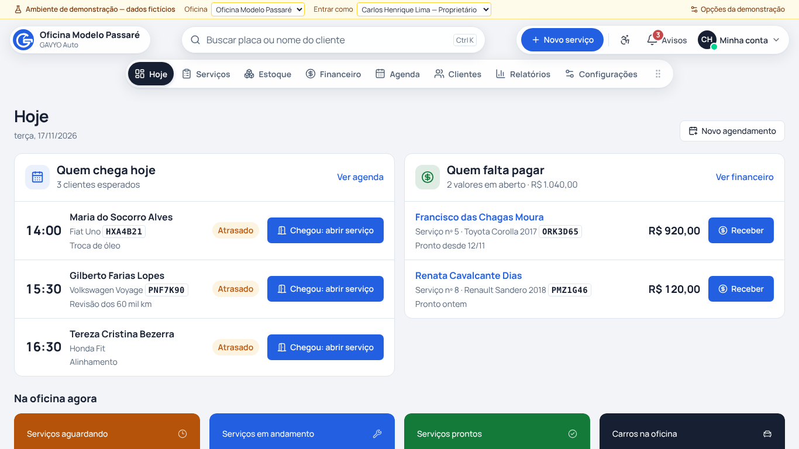
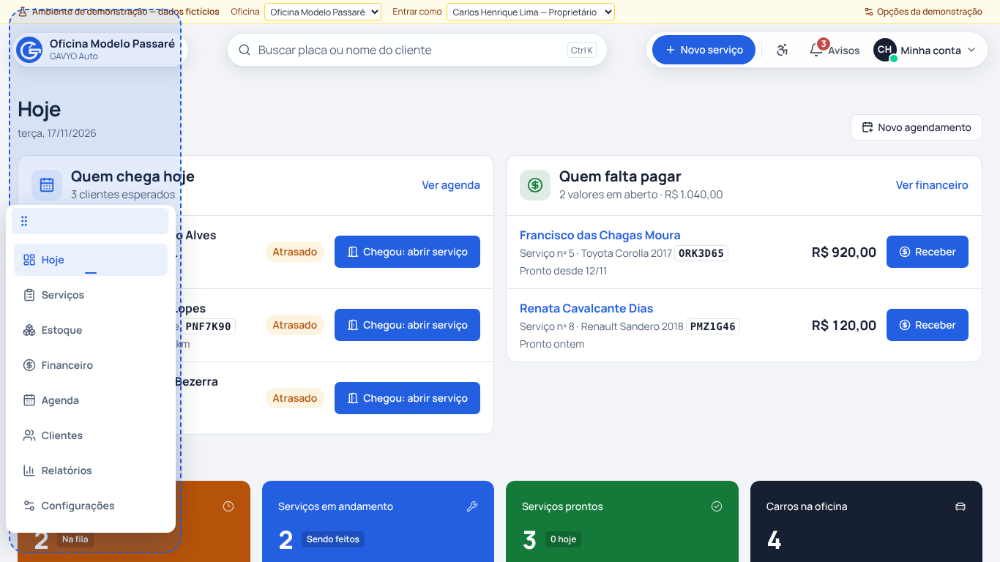
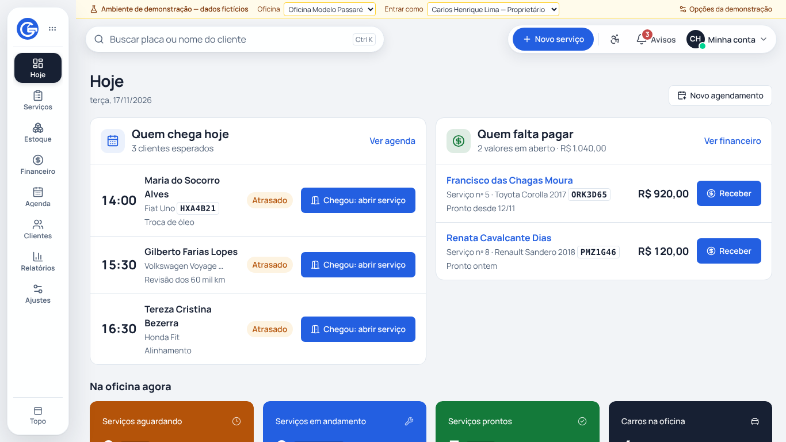
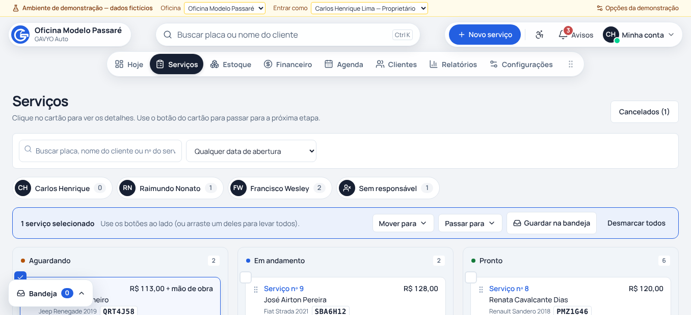
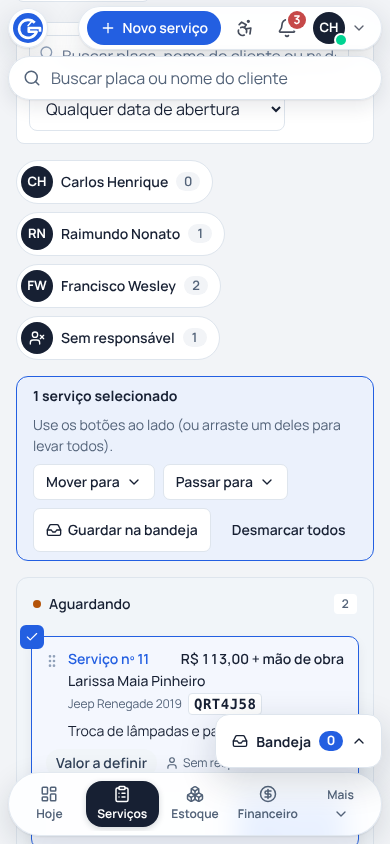
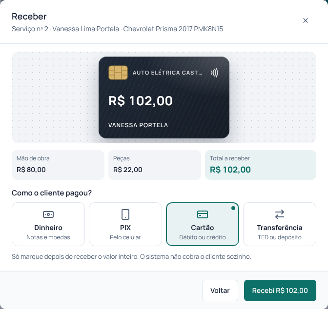
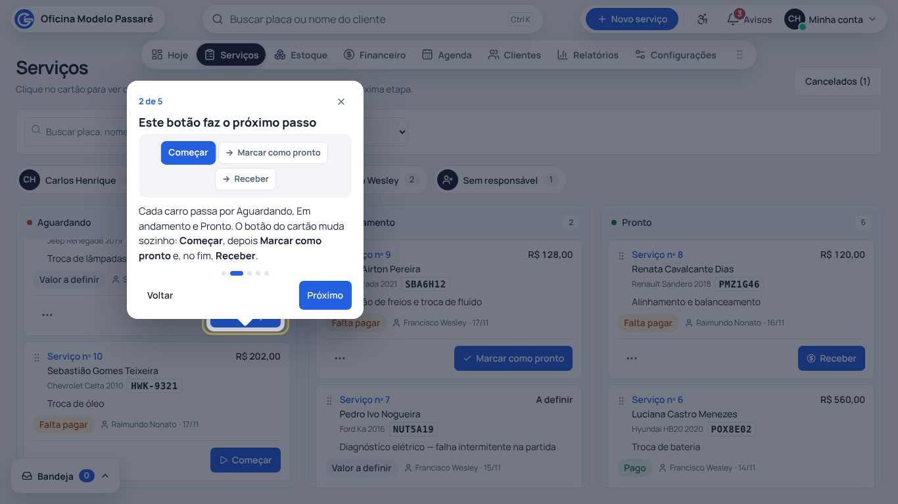
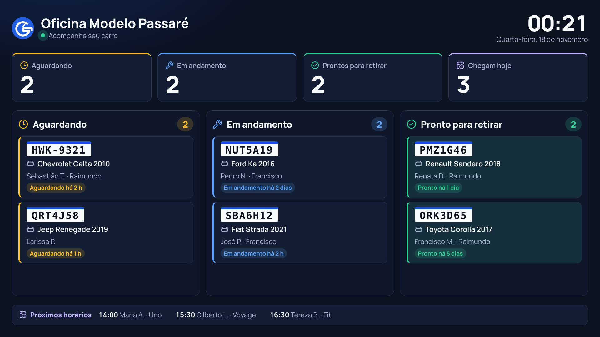

# Guia da interface — 17/11/2026

Como cada parte da tela funciona hoje. Público: **recepção no balcão e dono**, muitas vezes sem experiência com sistemas. Regra de ouro: o caminho principal é sempre um **botão escrito e visível**; arrastar, atalhos de teclado e recursos "de sistema operacional" são extras, nunca o único caminho.

Estilo assumido (decisão 49): **sistema operacional** — cabeçalho em ilhas de vidro, menu que se move e encaixa, bandeja, mini janela e animações que mostram o que aconteceu.

Termos usados na tela (decisão 37): **Serviço** (nunca "OS"), "Serviço nº 11", etapas **Aguardando / Em andamento / Pronto**, botões **Começar / Marcar como pronto / Receber**, "Falta pagar", "Sem internet".

---

## 1. Cabeçalho

| Linha | O que tem |
|---|---|
| 1 | Oficina (logo e nome) · **campo de busca** "Buscar placa ou nome do cliente" (Ctrl/⌘+K também foca) · **Novo serviço** · Acessibilidade · **Avisos** · **Minha conta** |
| 2 | Abas com nome: **Hoje, Serviços, Estoque, Financeiro, Agenda, Clientes, Relatórios, Configurações** (as que o cargo pode ver) |

- Quantas abas aparecem depende da largura: todas a partir de 1100 px, 6 + **Mais** no tablet, 4 + **Mais** no celular. A tela atual nunca vai para o "Mais".
- A **pílula da aba ativa desliza** até a aba nova (animação 4a).
- **Minha conta**: nome e cargo, **Menu na lateral / Menu no topo**, **Organizar tela inicial**, **Ver as dicas de novo**, **Sair**.
- **Sem internet**: aparece o selo "Sem internet" e uma faixa vermelha dizendo o que fica bloqueado (abrir serviço, mudar etapa, receber, estoque). Consultar continua possível.
- No celular: a linha 1 vira logo + Novo serviço + ícones; a busca vai para uma linha própria; as abas viram barra flutuante embaixo, com ícone e nome.

## 2. Menu: topo, lateral ou flutuante

| Posição | Como chegar | Como sair |
|---|---|---|
| **Topo** (padrão) | — | — |
| **Lateral** (a partir de 1100 px) | Arrastar a alça ⋮⋮ do menu até a borda esquerda ("Solte para fixar na lateral") · **Minha conta › Menu na lateral** · alça › **Fixar na lateral** | **Menu no topo** no rodapé da barra · arrastar a alça da barra até o topo · Minha conta |
| **Flutuante** | Arrastar a alça para o meio da tela · alça › Flutuar à esquerda/direita | Arrastar até o topo · alça › Encaixar no topo · tecla Home |

- **Menu lateral**: empurra a página para o lado; fica **recolhido** (ícone com nome curto embaixo, 108 px) e **abre com o mouse por cima** (240 px, por cima do conteúdo, sem empurrar de novo). Fecha ao tirar o mouse; o foco do teclado também abre.
- Ao fixar na lateral, a **logo voa do topo para a barra e estoura**; a barra desliza e o conteúdo é empurrado (detalhes em [ANIMACOES.md](ANIMACOES.md)).
- Posição salva por usuário e oficina, neste navegador.

## 3. Hoje (primeira tela depois de entrar)

- **Quem chega hoje**: horário grande, nome, carro e placa, o que foi marcado, selo **Próximo / Atrasado / Já chegou**. Botão **Chegou: abrir serviço** abre o Novo serviço já preenchido pelo agendamento; depois vira **Ver Serviço nº X**.
- **Quem falta pagar**: carros **prontos** ainda não pagos (e entradas a receber, para quem vê o Financeiro), com valor e "Pronto ontem / desde 12/11". Botão **Receber**. Recepção recebe (decisão 46); quem não tem permissão vê "Quem recebe: dono ou financeiro".
- Abaixo, **Na oficina agora**: indicadores, lista de serviços com a próxima ação, atividade recente e alertas de estoque. Pode ser reorganizado em **Minha conta › Organizar tela inicial** (arrastar ou botões em cada bloco; **Terminar** sai).
- Mecânico vê **Meus serviços** (só os dele, com Começar / Marcar como pronto).

## 4. Serviços (quadro)

- Três colunas: **Aguardando → Em andamento → Pronto**. Só a página rola (as colunas crescem), com folga no fim.
- Cada cartão: número, total, cliente, carro e placa, o que foi pedido, situação do pagamento, responsável e o **botão da próxima etapa** (**Começar**, **Marcar como pronto**, **Receber**). Ao clicar, o **cartão voa até a nova coluna** e brilha (animação 1).
- **Clicar no cartão** abre o resumo ao lado (painel). No painel: lançar peça com **+** / **−**, **mão de obra: clique no valor e digite**, responsável, **Ver serviço completo** e o botão da próxima etapa.
- **Ver serviço completo**: a janela **cresce a partir do cartão** (animação 3). Nela: peças, histórico, **Mudar etapa**, **Editar**, **Receber**, **Gerar PDF**, **WhatsApp** (orçamento/atualização) e **Cancelar serviço**.
- Busca da página, filtro por data e faixa de responsáveis (clicar filtra; soltar um cartão atribui).
- Extras (atalhos): arrastar o cartão pela alça ⋮⋮; **caixinha** no canto do cartão para marcar vários (barra com **Mover para / Passar para / Guardar na bandeja / Desmarcar todos**); menu **⋯** do cartão; tecla X; Ctrl/⌘+clique.
- **Cancelados (n)** lista os serviços cancelados, só para consulta.
- Serviço recém-aberto **nasce no quadro** (pop, anel e selo "Novo") quando o cartão aparece de verdade; contadores das colunas rolam até o número novo.

## 5. Receber

Janela com um **desenho da forma escolhida** e o valor: **cartão** genérico na cor da oficina (gira ao entrar), **cédulas** em leque, **celular** "Pix recebido", **comprovante** de transferência. Formas em 4 botões grandes (setas do teclado trocam). Em **Dinheiro**: "Quanto o cliente entregou?" com atalhos (**Exato**, notas redondas) e **troco** na hora; valor menor que o total mostra "Faltam R$ …" e bloqueia **Recebi R$ …**.

Ao confirmar: check verde, moedas, o valor **voa até a aba Financeiro** e a linha sai de "Quem falta pagar" (animação 2). Não pede dados de cartão, não usa marcas reais nem QR code (decisão 50).

## 6. Novo serviço

Campos: **Nome** (busca cliente existente ou cria), **Telefone**, **Placa / Marca / Modelo** (ou carro já cadastrado), **O que o cliente pediu**; opcionais: mecânico, mão de obra, observações, ano, quilometragem, peças. Se faltar algo, aparece de uma vez: "Falta preencher: nome, placa, marca, modelo e o que o cliente pediu." e cada campo fica vermelho com a frase do que escrever.

## 7. Demais telas

- **Agenda**: dia, semana, mês e próximos. Clicar no agendamento: confirmar, cancelar, **Chegou: abrir serviço**. Mudar dia/horário: botão de calendário do cartão (ou arrastar).
- **Estoque**: peças, **Entrada / Saída** por peça ("Chegou peça / Saiu peça / Contei o estoque", mostra "Vai ficar com"), aba **Histórico de peças** (coluna "Ficou com").
- **Financeiro**: indicadores (inclui **Sobrou no caixa**), gráfico (com tabela acessível), recebimentos, despesas, **Entrada sem serviço**, contas a receber com **Receber**.
- **Clientes e veículos**: busca, cadastro, serviços de cada cliente/veículo, **Novo serviço para este cliente/veículo**.
- **Relatórios**: Serviços, Dinheiro que entrou e saiu, Contas a receber, Peças em estoque, Histórico de peças, Histórico de serviços; PDF e Excel.
- **Configurações**: dados, logo e cores da oficina, módulos, funcionários e permissões.

## 8. Recursos de "sistema operacional"

| Recurso | Onde | Alternativa sem gesto |
|---|---|---|
| **Bandeja** (segurar para depois) | Canto inferior esquerdo; arraste serviços ou peças | ⋯ › **Guardar na bandeja**; clicar na bandeja vazia explica o uso |
| **Mini janela** por cima de outros programas | Painel do serviço, ícone ao lado do ✕ (Chrome/Edge) | — (opcional) |
| **Seleção múltipla** | Caixinha do cartão, X, Ctrl/⌘+clique | Barra de seleção com botões |
| **Ajustar arrastando** | Quantidade e mão de obra no painel | Clicar e digitar; − / + |
| **Atalhos** | N novo serviço · G + letra abre módulo · Ctrl/⌘+Z desfaz | Botões e abas |
| **Desfazer** | Aviso após mudar etapa, reagendar, atribuir | — |

## 9. Dicas de primeira vez (tour)

Balões em sequência ("1 de 5") que escurecem a tela, recortam o elemento e apontam com seta animada, com pequenas ilustrações. Telas: **Hoje** (3 passos), **Serviços** (5), **painel do serviço** (4). Pular, ✕ ou Esc encerram; ← → navegam. Aparecem uma vez por usuário e oficina; não aparecem por baixo de uma janela aberta. **Minha conta › Ver as dicas de novo** mostra de novo.

## 10. Modo TV da parede

**Minha conta › Modo TV da parede** (abre `/tv` em outra aba; ideal num computador ligado à TV da oficina ou da sala de espera). Tela escura de alto contraste que se lê de longe: relógio, 4 números grandes (**Aguardando, Em andamento, Prontos para retirar, Chegam hoje**), quadro com **placa em destaque**, carro, primeiro nome + inicial do sobrenome, mecânico e há quanto tempo está na etapa, e rodapé com os **próximos horários**. Sem valores em reais (tela pública).

- Atualiza sozinho, inclusive quando a recepção mexe em outra aba/janela do mesmo navegador; carro que chega ou muda de etapa brilha por alguns segundos e os números rolam.
- Cabe na tela que estiver: mede quantos cartões cabem; se tiver mais, troca de página a cada 10 s (pontinhos embaixo).
- Controles somem com o mouse parado: **Tela cheia (F)** e **Sair da TV (Esc)**.
- Só mostra "Prontos para retirar" que ainda não foram pagos.

## 11. Demonstração

Barra amarela: trocar **Oficina** (a cor nova varre a tela a partir da logo — animação 4b) e **Entrar como** (cargo). **Opções da demonstração**: simular queda de conexão e restaurar os dados iniciais.
