# Guia da interface — 17/11/2026

Como cada parte da tela funciona hoje. Público: **recepção no balcão e dono**, muitas vezes sem experiência com sistemas. Regra de ouro: o caminho principal é sempre um **botão escrito e visível**; arrastar, atalhos de teclado e recursos "de sistema operacional" são extras, nunca o único caminho.

Estilo assumido (decisão 49): **sistema operacional** — cabeçalho em ilhas de vidro, menu que se move e encaixa, bandeja, mini janela e animações que mostram o que aconteceu.

Termos usados na tela (decisão 37): **Serviço** (nunca "OS"), "Serviço nº 11", etapas **Aguardando / Em andamento / Pronto**, botões **Começar / Marcar como pronto / Receber**, "Falta pagar", "Sem internet".

---

## 1. Cabeçalho

| Linha | O que tem |
|---|---|
| 1 | Oficina (logo e nome) · **campo de busca** "Buscar placa ou nome do cliente" (Ctrl/⌘+K também foca) · **Novo serviço** · Acessibilidade · **Avisos** · **Minha conta** |
| 2 | Abas com nome: **Hoje, Serviços, Estoque, Financeiro, Agenda, Clientes, Relatórios, Configurações** (as que o cargo pode ver) |

- Quantas abas aparecem depende da largura: todas a partir de 1100 px, 6 + **Mais** no tablet, 4 + **Mais** no celular. A tela atual nunca vai para o "Mais".
- A **pílula da aba ativa desliza** até a aba nova (animação 4a).
- **Minha conta**: nome e cargo, **Menu na lateral / Menu no topo**, **Organizar tela inicial**, **Ver as dicas de novo**, **Sair**.
- **Sem internet**: aparece o selo "Sem internet" e uma faixa vermelha dizendo o que fica bloqueado (abrir serviço, mudar etapa, receber, estoque). Consultar continua possível.
- No celular: a linha 1 vira logo + Novo serviço + ícones; a busca vai para uma linha própria; as abas viram barra flutuante embaixo, com ícone e nome.

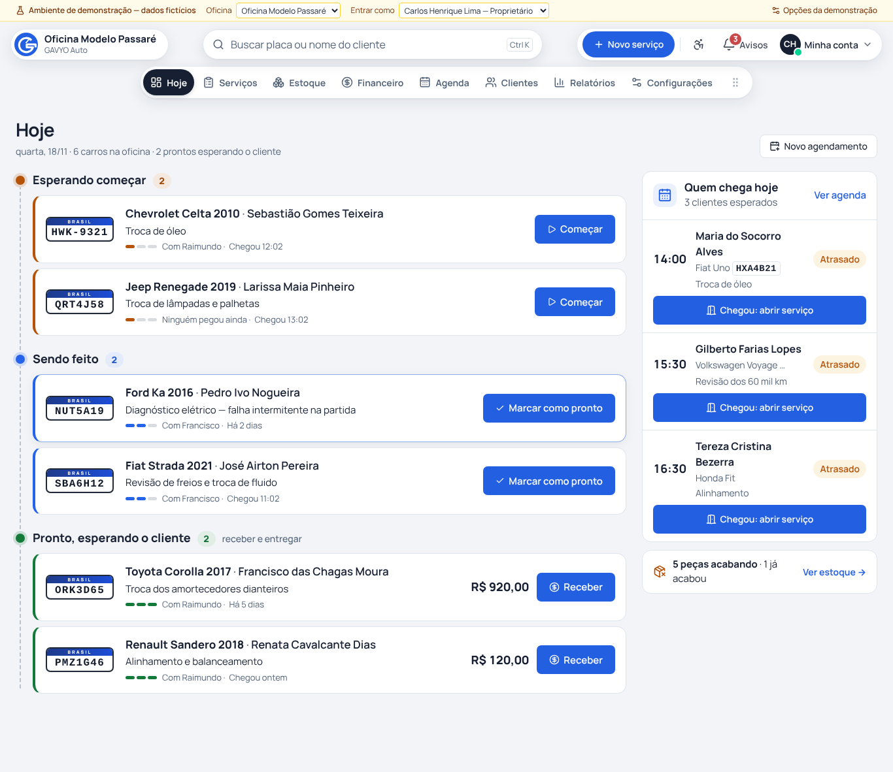

## 2. Menu: topo, lateral ou flutuante

| Posição | Como chegar | Como sair |
|---|---|---|
| **Topo** (padrão) | — | — |
| **Lateral** (a partir de 1100 px) | Arrastar a alça ⋮⋮ do menu até a borda esquerda ("Solte para fixar na lateral") · **Minha conta › Menu na lateral** · alça › **Fixar na lateral** | **Menu no topo** no rodapé da barra · arrastar a alça da barra até o topo · Minha conta |
| **Flutuante** | Arrastar a alça para o meio da tela · alça › Flutuar à esquerda/direita | Arrastar até o topo · alça › Encaixar no topo · tecla Home |

- **Menu lateral**: empurra a página para o lado; fica **recolhido** (ícone com nome curto embaixo, 108 px) e **abre com o mouse por cima** (240 px, por cima do conteúdo, sem empurrar de novo). Fecha ao tirar o mouse; o foco do teclado também abre.
- Ao fixar na lateral, a **logo voa do topo para a barra e estoura**; a barra desliza e o conteúdo é empurrado (detalhes em [ANIMACOES.md](ANIMACOES.md)).
- Posição salva por usuário e oficina, neste navegador.

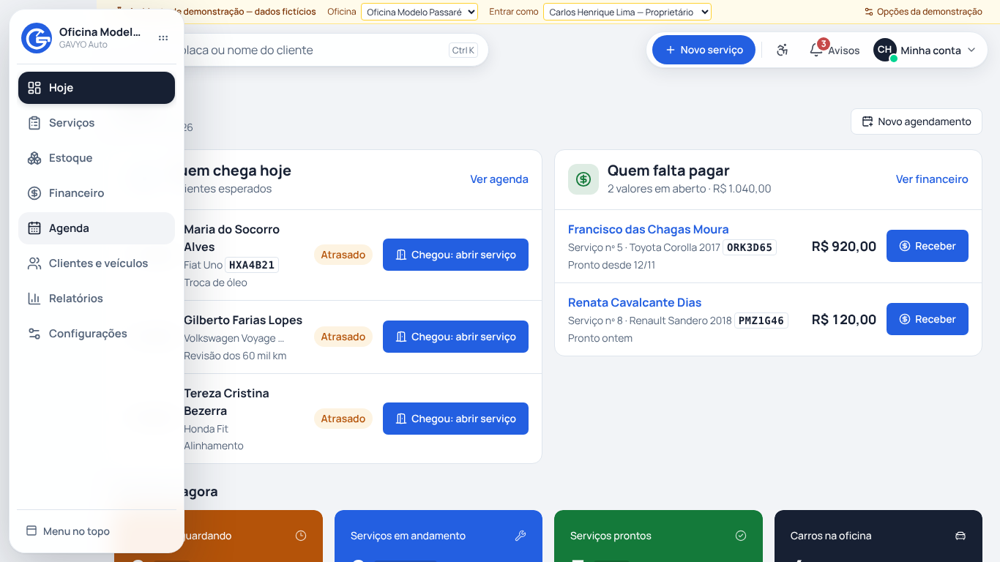

## 3. Hoje = o pátio (primeira tela depois de entrar)

Decisão 58. A tela responde **"que carros estão aqui e o que cada um precisa agora?"**.

- Subtítulo em frase: "quarta, 18/11 · 6 carros na oficina · 2 prontos esperando o cliente". Não há mais cartões coloridos de números.
- **O pátio**: os carros em **linhas largas**, agrupados pelo caminho do carro: **Esperando começar** (âmbar) → **Sendo feito** (azul fixo) → **Pronto, esperando o cliente** (verde). Uma "estrada" tracejada liga os grupos. Cada linha tem a **placa desenhada** (a mesma do Novo serviço), o carro e o cliente, o serviço, o caminho em 3 tracinhos, quem está fazendo e há quanto tempo o carro chegou, e **um botão só**: Começar → Marcar como pronto → **Receber** (com o valor). Ao clicar, a linha desce para o próximo grupo e brilha. O carro sai do pátio quando é pago.
- **Coluna ao lado** (abaixo no celular): **Quem chega hoje** (Chegou: abrir serviço) e avisos de uma linha: "5 peças acabando → Ver estoque" e valores a receber fora de serviço (para o Financeiro).
- Saíram: a tabela com 5 filtros e busca (o quadro de Serviços já faz isso), a atividade recente e o cartão de alertas de estoque.
- **Mecânico** vê **"Seus carros, Nome"**: só os carros dele (Você está fazendo / Para você começar), sem dinheiro, e uma frase "1 carro está esperando alguém pegar — ver no quadro".
- Recepção sem permissão para concluir vê "O mecânico marca quando ficar pronto" no lugar do botão.
- Financeiro continua com o painel de números e "Organizar tela inicial" (só ele tem essa opção).

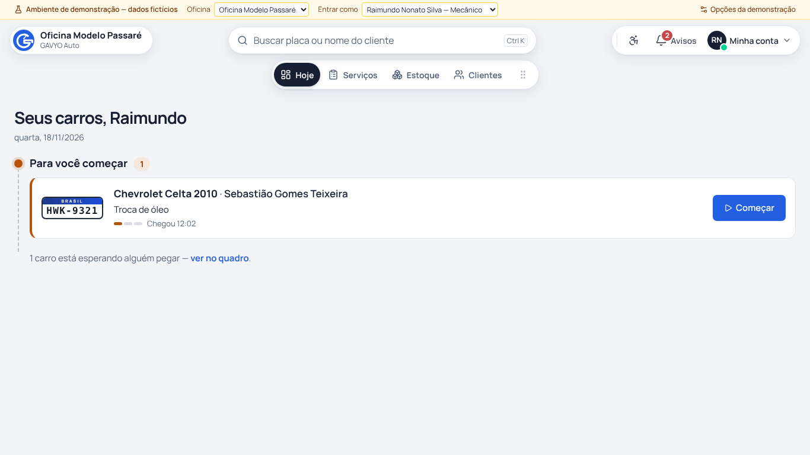
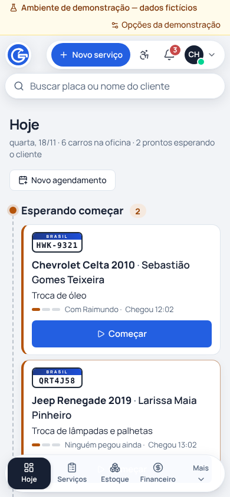

## 4. Serviços (uma tela por etapa)

Decisão 59. No lugar das três colunas, **três abas grandes**: **Aguardando · Em andamento · Pronto**, cada uma com o número de carros e uma frase ("1 sem ninguém", "2 faltam receber"). ← → trocam de aba pelo teclado.

- Clicar no carro abre a **ficha do serviço** (seção 4.1). Não há mais painel lateral.
- Cada carro é um **cartão branco** no estilo da navegação: placa desenhada, carro · cliente, serviço, nº, responsável e há quanto tempo; à direita o valor, **um botão** (Começar / Marcar como pronto / Receber) e "⋯". 
- **Pronto** separa **Falta receber** e **Pagos e entregues**.
- Ao clicar no botão, a linha **voa até a aba** da próxima etapa e a aba pula com o número novo.
- **Busca** e **Filtrar** (aberto quando, quem está fazendo, ver cancelados). Se a busca achar o carro em outra etapa: "Achamos 1 em Pronto →".
- Atalhos que continuam: arrastar (pela alça que aparece ao passar o mouse) e soltar numa aba ou num responsável; selecionar vários (caixinha, X, Ctrl/⌘+clique); bandeja.
- Abas como o controle segmentado do iPhone: trilho cinza, aba escolhida branca e elevada, número na cor da etapa. Ícones Phosphor duotone: ampulheta, chave inglesa, selo de concluído.

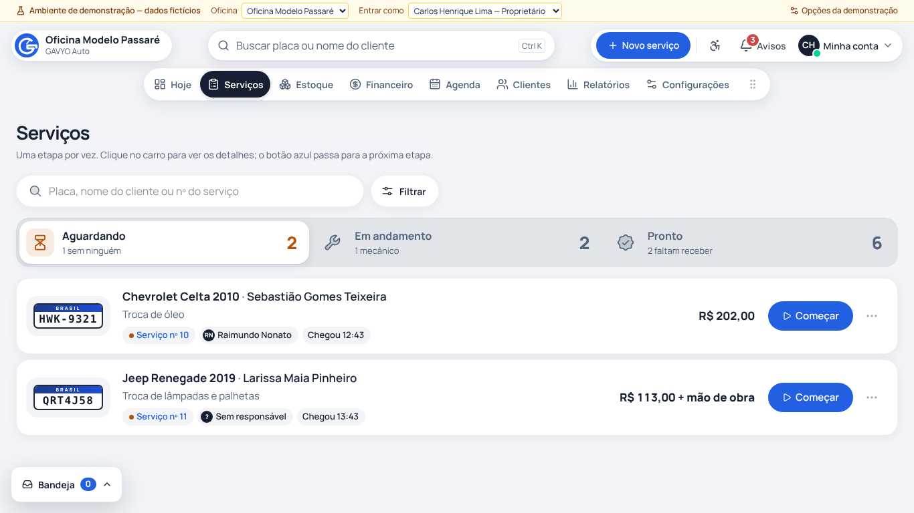
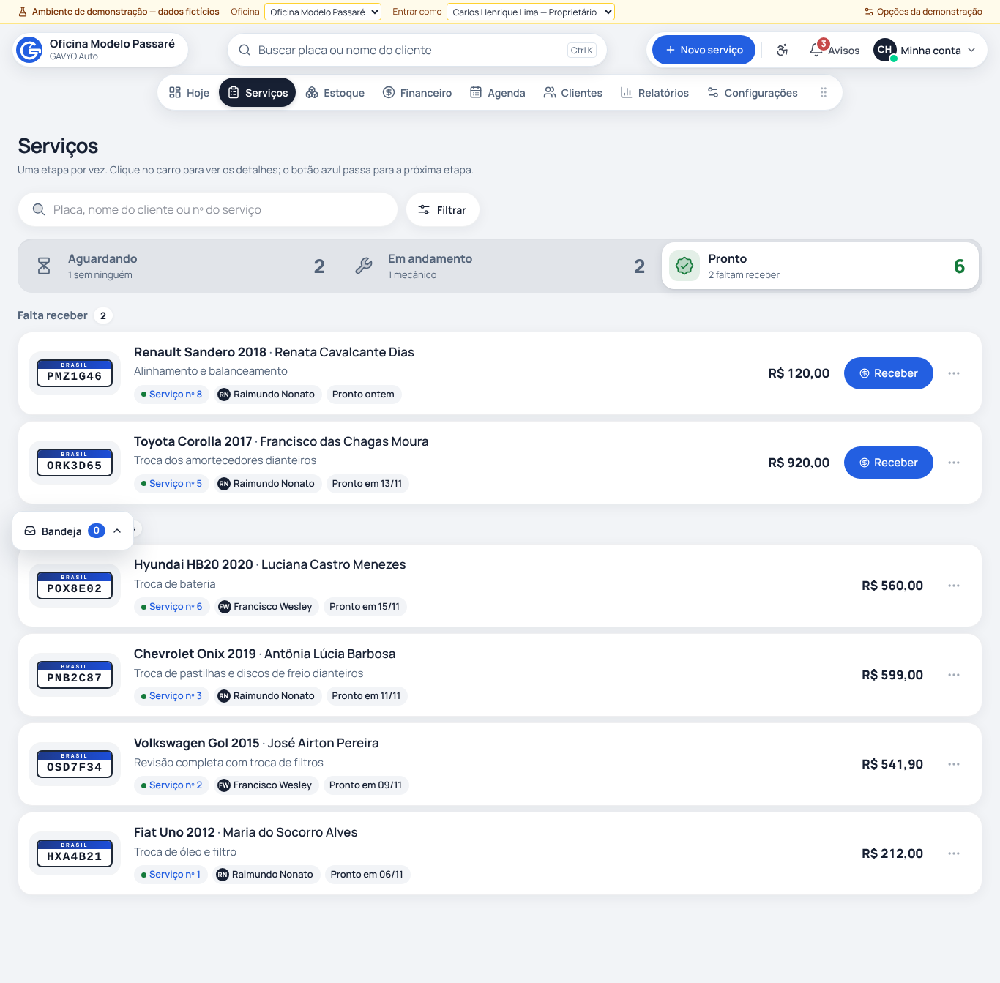
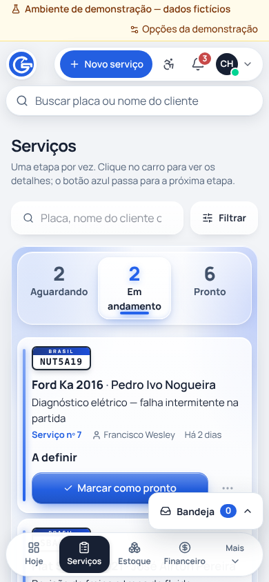

### 4.1 Ficha do serviço (decisão 60)

- **Cabeçalho**: placa desenhada, carro, cliente, nº e quando abriu, e o **caminho do serviço** (Aguardando → Em andamento → Pronto → Pago). Clicar num passo muda a etapa (mesmas permissões); "Pago" abre o Receber.
- **Esquerda**: O que fazer (com "Trocar quem faz" na própria ficha), Peças em linhas ("Adicionar ou tirar" abre a busca de peças ali mesmo), O que aconteceu (recolhido).
- **Direita**: Quanto custa (total grande, mão de obra, peças, "Definir mão de obra", situação do pagamento) e ações escritas: Ligar, Avisar no WhatsApp, Mandar orçamento, Gerar PDF, Cancelar serviço.
- **Rodapé**: Editar serviço e um botão principal (Começar / Marcar como pronto / Receber R$ X).

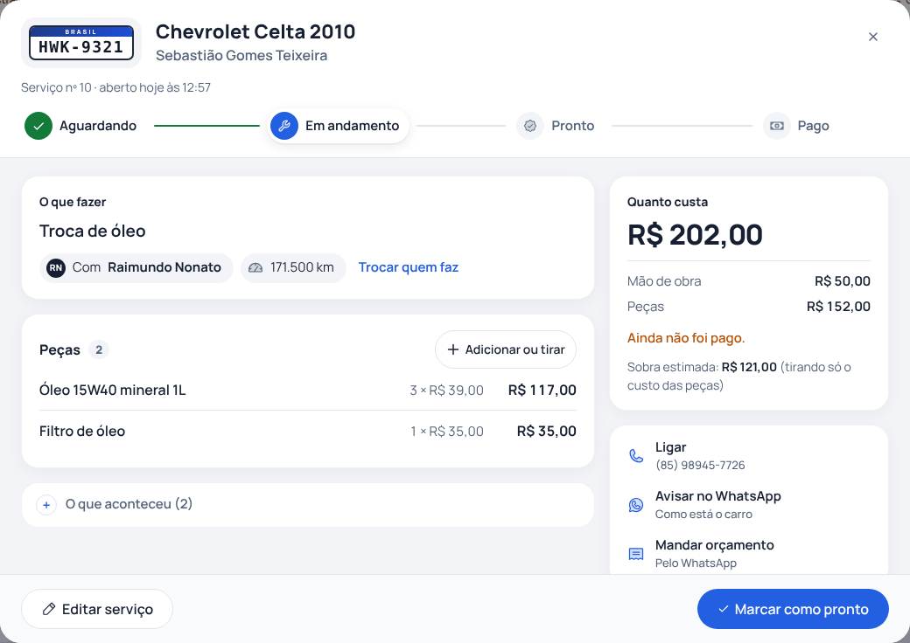
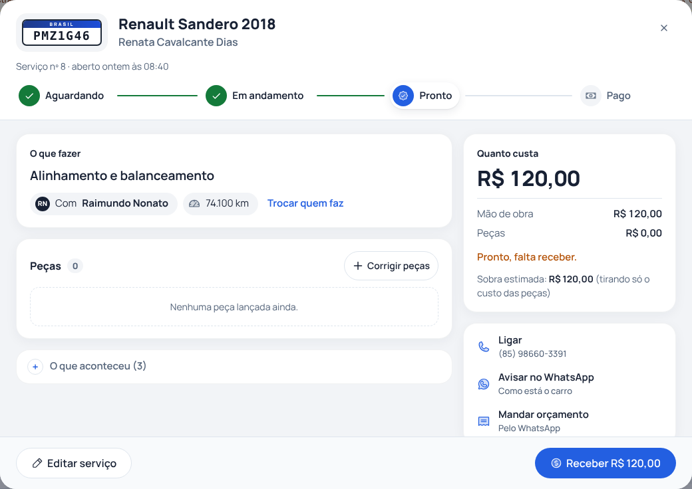
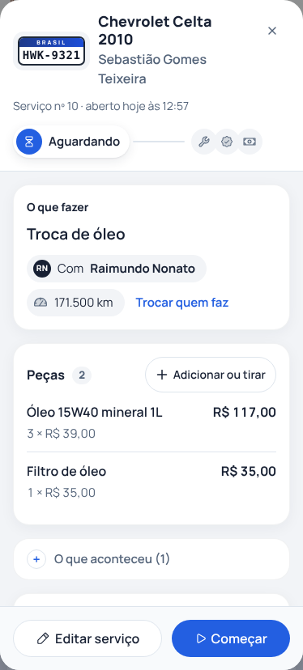

## 5. Receber

Janela com um **desenho da forma escolhida** e o valor: **cartão** genérico na cor da oficina (gira ao entrar), **cédulas** em leque, **celular** "Pix recebido", **comprovante** de transferência. Formas em 4 botões grandes (setas do teclado trocam). Em **Dinheiro**: "Quanto o cliente entregou?" com atalhos (**Exato**, notas redondas) e **troco** na hora; valor menor que o total mostra "Faltam R$ …" e bloqueia **Recebi R$ …**.

Ao confirmar: check verde, moedas, o valor **voa até a aba Financeiro** e a linha sai de "Quem falta pagar" (animação 2). Não pede dados de cartão, não usa marcas reais nem QR code (decisão 50).

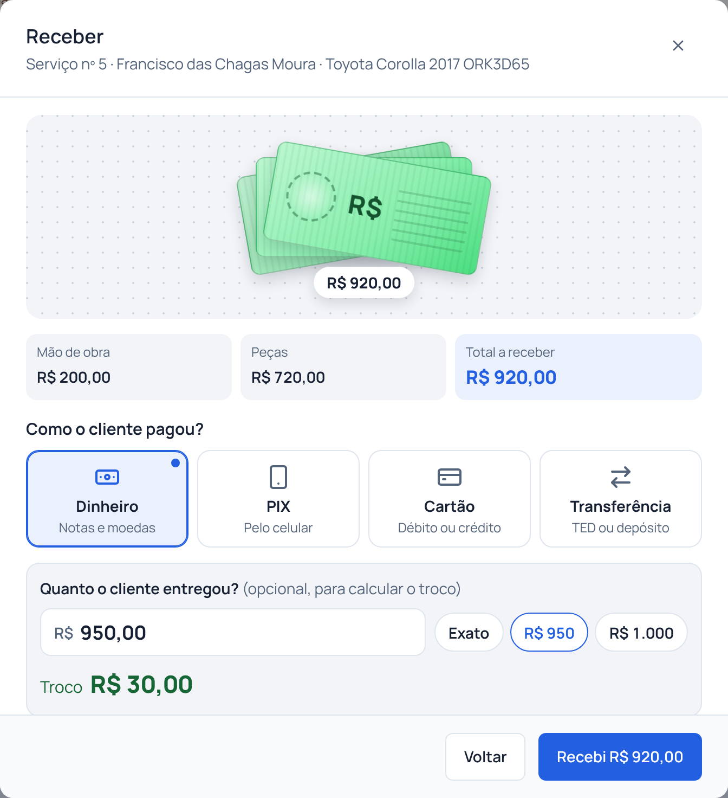

## 6. Novo serviço (passo a passo)

Uma pergunta por vez, em tom de conversa, com etapas de ícone no topo (**Placa → Carro → Cliente → Serviço → Quem faz → Conferir**):

1. **Qual a placa do carro?** — digitada numa placa desenhada. Se o carro já existe, aparece **"Achamos o carro: Jeep Renegade 2019 de Larissa…"** e os passos de carro e cliente são pulados. Sem placa? **Procurar pelo nome do cliente** (e escolher o carro, se ele tiver mais de um).
2. **Que carro é?** (só carro novo) — marca com atalhos (Fiat, Volkswagen…) e modelo; ano e quilometragem em "Mais detalhes".
3. **De quem é o carro?** (só cliente novo) — o avatar se forma com as iniciais; se o nome já existe, oferece "Já é cliente? Toque no nome"; telefone com DDD.
4. **O que o cliente pediu?** — texto livre ou blocos com ícone (Troca de óleo, Revisão, Freios…).
5. **Quem vai fazer o serviço?** — cartões de cada mecânico com "Livre agora / 2 carros agora", ou "Ainda não sei".
6. **Está tudo certo?** — prévia do cartão que vai entrar em Aguardando, respostas com **Alterar**, e "Mais detalhes (opcional)": mão de obra (**Ainda não sei / Já sei o valor / Não vai cobrar**), peças e observações.

Enter continua; **Voltar** sempre visível; o aviso aparece em palavras simples e o cursor volta para o campo. Vindo de **Chegou: abrir serviço**, já começa preenchido.

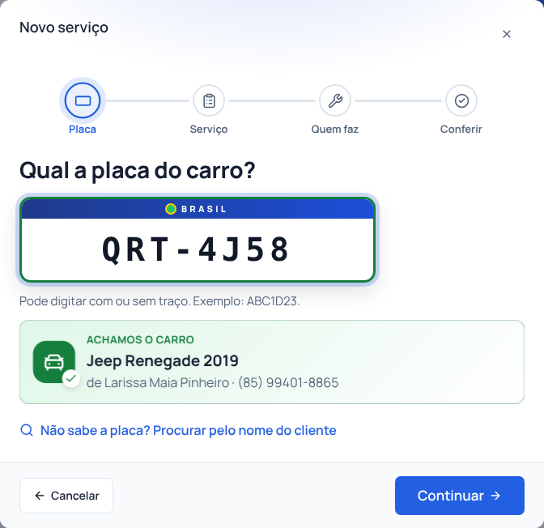
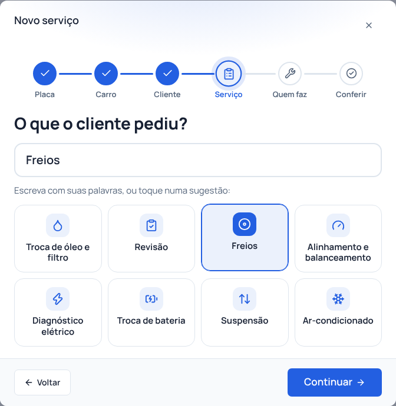
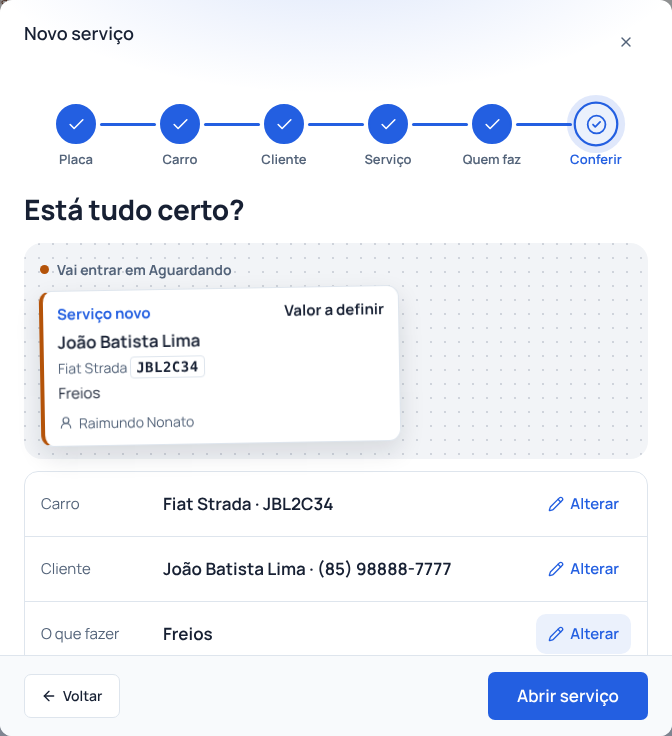

### Formulários: escolhas em botões (decisão 57)

Todos os formulários seguem a linguagem do Novo serviço: **pergunta em tom de conversa** ("Que dia?", "Quem vai fazer?", "Com o que gastou?"), **escolhas em botões grandes** no lugar de listas suspensas (mecânico, categoria, tipo de movimento, função, situação), **Hoje / Amanhã / dias da semana** e **horários em botões** (calendário só em "Outro dia"), e o que é opcional dentro de **"Mais detalhes (opcional)"** com a lista do que tem lá. Lista suspensa só sobrou para listas longas (cliente). Peças de um serviço: **busca + lista com "Adicionar"**. Peças em `src/components/ui/choice.tsx` (`ChoiceGroup`, `DayPicker`, `TimePicker`, `MoreDetails`): por baixo são rádios de verdade (setas trocam, leitor de tela anuncia o grupo).

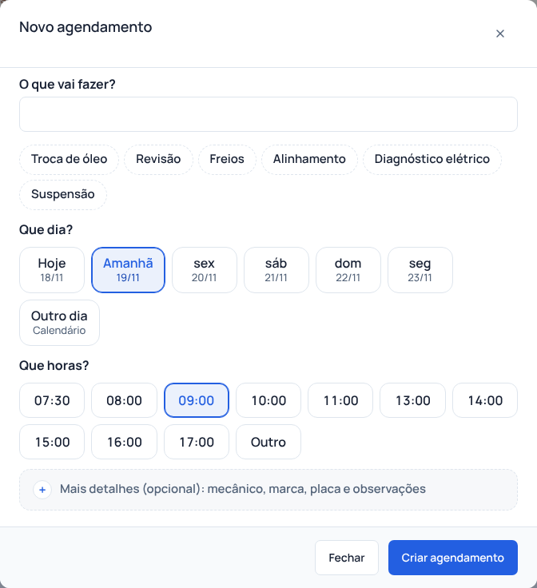
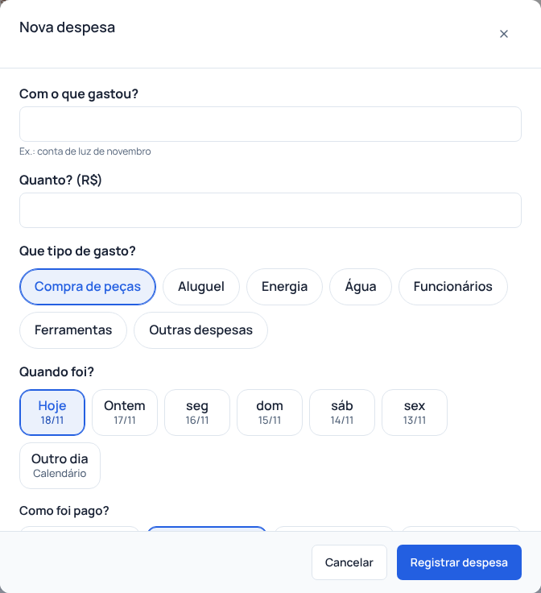
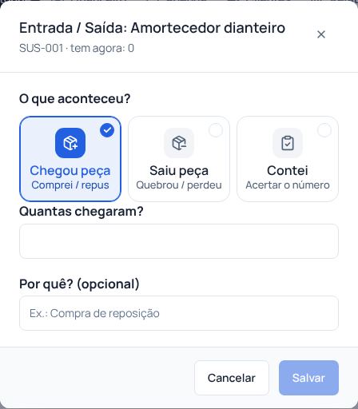
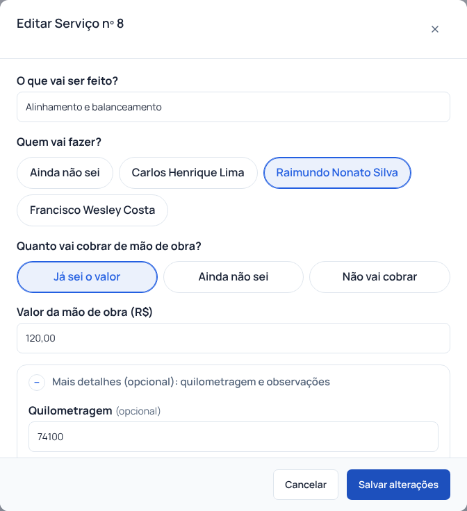
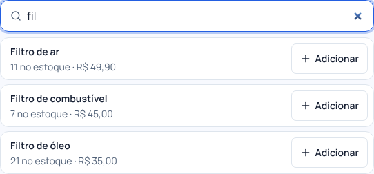

## 7. Demais telas

- **Agenda**: dia, semana, mês e próximos. Clicar no agendamento: confirmar, cancelar, **Chegou: abrir serviço**. Mudar dia/horário: botão de calendário do cartão (ou arrastar).
- **Estoque**: peças, **Entrada / Saída** por peça ("Chegou peça / Saiu peça / Contei o estoque", mostra "Vai ficar com"), aba **Histórico de peças** (coluna "Ficou com").
- **Financeiro**: indicadores (inclui **Sobrou no caixa**), gráfico (com tabela acessível), recebimentos, despesas, **Entrada sem serviço**, contas a receber com **Receber**.
- **Pessoas** (decisão 62): busca + abas Clientes / Funcionários / Carros em cartões. Novo cliente ou funcionário: crachá que se preenche + carimbo "Cadastro concluído". Ficha do funcionário: foto, telefone, função, acesso e permissões.
- **Relatórios**: Serviços, Dinheiro que entrou e saiu, Contas a receber, Peças em estoque, Histórico de peças, Histórico de serviços; PDF e Excel.
- **Configurações**: dados, logo e cores da oficina e módulos. Funcionários e permissões ficam em Pessoas.

### Pessoas e crachá

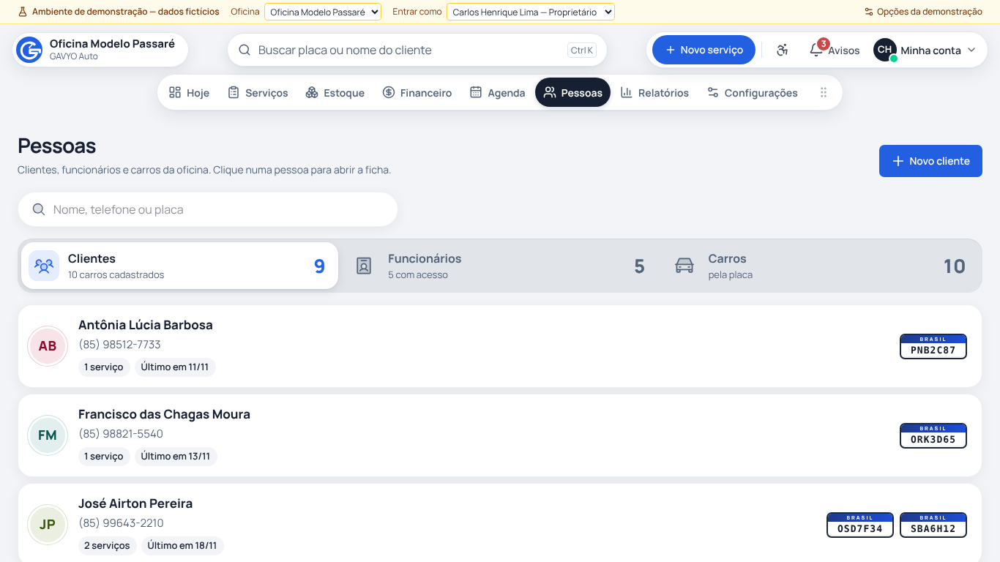
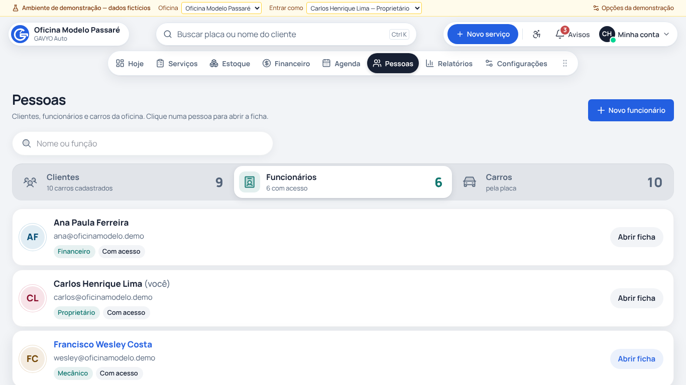
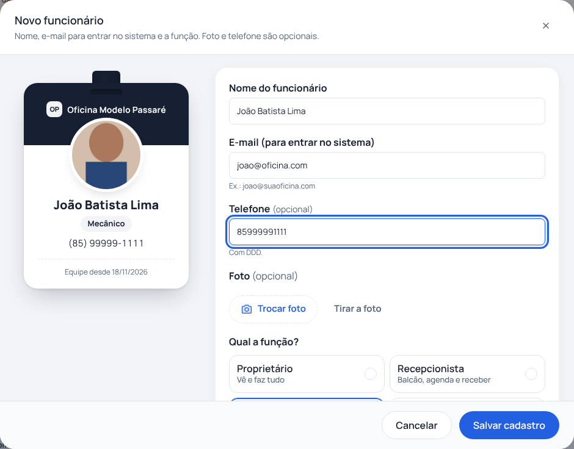
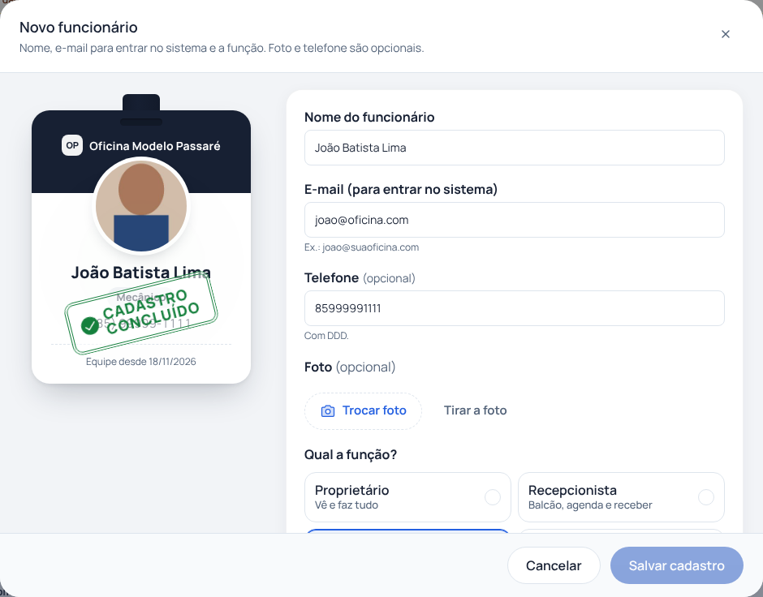
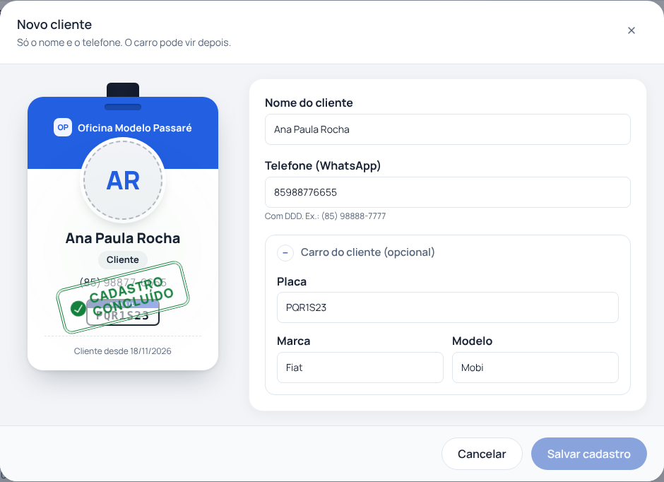

### Máscaras e paginação (decisão 64)

Telefone, placa, dinheiro, e-mail e quilometragem se formatam enquanto a pessoa digita. Listas longas mostram 12–25 itens por página com "Mostrando 1 a 12 de 49" e Anterior/Próxima.

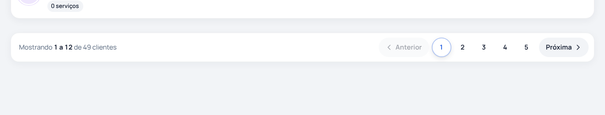

## 8. Recursos de "sistema operacional"

| Recurso | Onde | Alternativa sem gesto |
|---|---|---|
| **Bandeja** (segurar para depois) | Canto inferior esquerdo; arraste serviços ou peças | ⋯ › **Guardar na bandeja**; clicar na bandeja vazia explica o uso |
| **Mini janela** por cima de outros programas | Painel do serviço, ícone ao lado do ✕ (Chrome/Edge) | — (opcional) |
| **Seleção múltipla** | Caixinha do cartão, X, Ctrl/⌘+clique | Barra de seleção com botões |
| **Ajustar arrastando** | Quantidade e mão de obra no painel | Clicar e digitar; − / + |
| **Atalhos** | N novo serviço · G + letra abre módulo · Ctrl/⌘+Z desfaz | Botões e abas |
| **Desfazer** | Aviso após mudar etapa, reagendar, atribuir | — |

## 9. Dicas de primeira vez (tour)

Balões em sequência ("1 de 5") que escurecem a tela, recortam o elemento e apontam com seta animada, com pequenas ilustrações. Telas: **Hoje** (4 passos), **Serviços** (5), **painel do serviço** (4). Pular, ✕ ou Esc encerram; ← → navegam. Aparecem uma vez por usuário e oficina; não aparecem por baixo de uma janela aberta. **Minha conta › Ver as dicas de novo** mostra de novo.

## 10. Modo TV da parede

**Minha conta › Modo TV da parede** (abre `/tv` em outra aba; ideal num computador ligado à TV da oficina ou da sala de espera). Tela escura de alto contraste que se lê de longe: relógio, 4 números grandes (**Aguardando, Em andamento, Prontos para retirar, Chegam hoje**), quadro com **placa em destaque**, carro, primeiro nome + inicial do sobrenome, mecânico e há quanto tempo está na etapa, e rodapé com os **próximos horários**. Sem valores em reais (tela pública).

- Atualiza sozinho, inclusive quando a recepção mexe em outra aba/janela do mesmo navegador; carro que chega ou muda de etapa brilha por alguns segundos e os números rolam.
- Cabe na tela que estiver: mede quantos cartões cabem; se tiver mais, troca de página a cada 10 s (pontinhos embaixo).
- Controles somem com o mouse parado: **Tela cheia (F)** e **Sair da TV (Esc)**.
- Só mostra "Prontos para retirar" que ainda não foram pagos.

## 11. Demonstração

Barra amarela: trocar **Oficina** (a cor nova varre a tela a partir da logo — animação 4b) e **Entrar como** (cargo). **Opções da demonstração**: simular queda de conexão e restaurar os dados iniciais.
