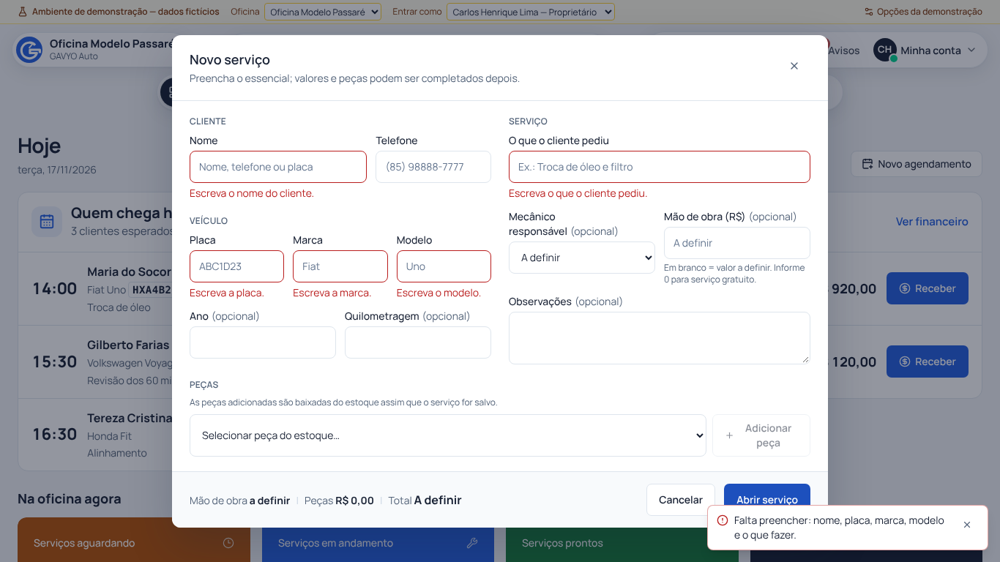
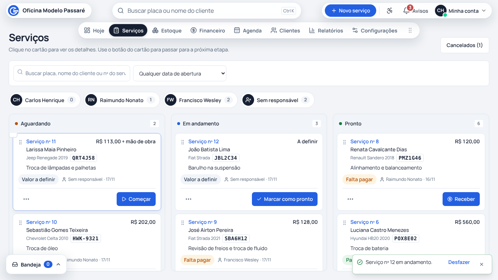
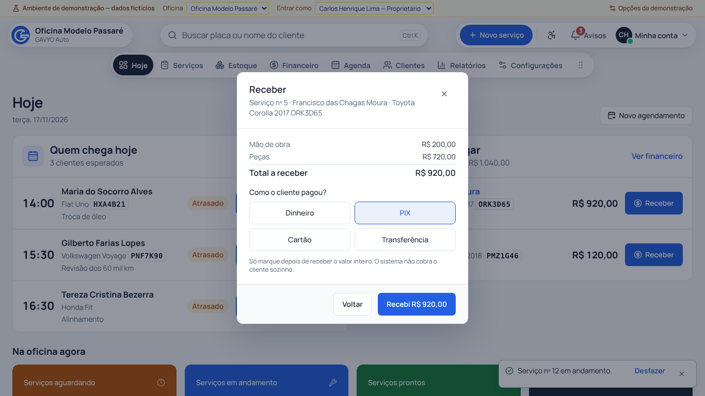
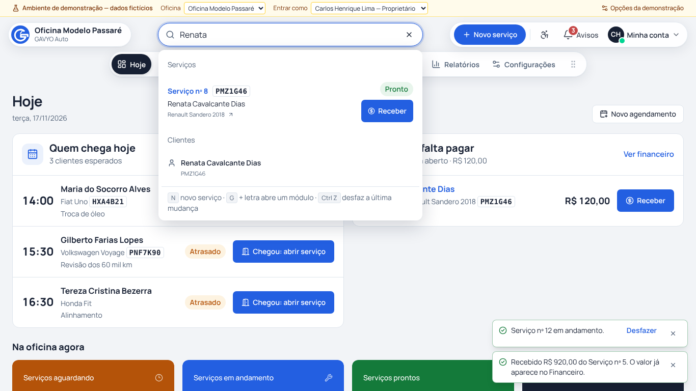

# Validação "uso sem treino" — 17/11/2026 (passo 6)

## Como foi feito
Simulação automática de uma pessoa sem experiência ([simular-sem-treino.js](simular-sem-treino.js)): ela só clica em botões e campos **pelo nome escrito na tela** (sem atalhos, sem arrastar, sem Ctrl+K) e lê o tour de primeira vez até o fim. Em cada tela, roda o axe-core (WCAG 2.0/2.1/2.2 A e AA).

Cenários: Proprietário em 1366×768 e 390 px; Recepcionista em 1366×768. Dados da demonstração (Oficina Modelo Passaré).

Não substitui um teste com uma pessoa real: veja o roteiro no fim.

## Resultado das 4 tarefas

| Tarefa | O que a pessoa faz (só texto visível) | Cliques + campos | Proprietário 1366 | Proprietário 390 | Recepcionista |
|---|---|---|---|---|---|
| 1. Abrir serviço (carro sem agendamento) | **Novo serviço** → Nome, Telefone, Placa, Marca, Modelo, O que o cliente pediu → **Abrir serviço** | 2 cliques + 6 campos | ✅ | ✅ | ✅ |
| 2. Mudar etapa | aba **Serviços** → no cartão, **Começar** | 2 cliques (+5 do tour na 1ª vez) | ✅ | ✅ | ✅ |
| 3. Receber | aba **Hoje** → **Receber** ao lado do nome → **PIX** → **Recebi R$ …** | 4 cliques | ✅ | ✅ | — sem permissão (ver abaixo) |
| 4. Achar cliente ("a Renata ligou") | campo **Buscar placa ou nome do cliente** → "Renata" → resultado | 2 cliques + 1 campo | ✅ | ✅ | ✅ |

Todas dentro da meta do PRODUCT.md (ação principal em até 3 cliques, sem contar campos obrigatórios e confirmação).

Pelo caminho que já existia na tela Hoje, quem tem agendamento chega com **1 clique** (Chegou: abrir serviço) e só confere os dados.

## O que a simulação encontrou e foi corrigido neste passo
1. **Tentar abrir serviço sem preencher** mostrava só "Descreva o serviço." (um erro por vez, sem indicar o campo). Agora: aviso "Falta preencher: nome, placa, marca, modelo e o que o cliente pediu." e cada campo em vermelho com a frase do que escrever. O campo "Descrição do serviço" passou a se chamar **O que o cliente pediu**.
2. **Alça de arrastar do cartão** com 20 px de largura e coberta pela caixinha de seleção quando o cartão tinha foco (axe `target-size`, WCAG 2.5.8). Alça com 24 px e caixinha afastada.
3. **Nome do cliente em "Quem falta pagar"** com área de clique baixa: altura mínima de 32 px.

Depois das correções: **axe sem violações** em Hoje, Serviços e detalhes do serviço, nos três cenários.

Observação: no celular, o axe acusava alvos enquanto passavam **por baixo do cabeçalho fixo** durante a rolagem; com a página parada não há sobreposição. O foco do teclado não fica escondido (scroll-padding, WCAG 2.4.11).

## Pontos que dependem de decisão
- **Recepcionista não recebe pagamento** (cargo padrão sem `finance.payment`). A tela Hoje mostra a lista com o aviso "Quem recebe: dono ou financeiro". Se a recepção do balcão deve receber, o dono libera em Configurações ou muda-se o cargo padrão (é regra, não layout).
- **Tour na 1ª vez** soma 3 a 5 cliques de "Próximo". Aceito: aparece uma vez e pode ser pulado (Pular, ✕ ou Esc).

## Roteiro para teste com uma pessoa real (15 minutos)
Ideal: alguém do balcão que nunca viu o sistema. Não explique nada; só leia a tarefa e observe. Anote onde a pessoa hesita mais de 5 segundos, o que ela fala em voz alta e onde clica errado.

1. "Entre como Recepcionista." (tela de login)
2. "Chegou o Seu João, de Strada, placa JBL2C34, reclamando de barulho na suspensão. Registre." → espera-se **Novo serviço**.
3. "A Maria do Socorro, que estava marcada, acabou de chegar." → espera-se **Chegou: abrir serviço** na tela Hoje.
4. "O mecânico começou o carro do Seu João. Atualize." → **Serviços** › **Começar**.
5. "A Renata ligou perguntando do carro dela. Ache e diga em que etapa está." → busca no topo.
6. Entre como Proprietário: "O Francisco veio buscar o Corolla e pagou no PIX." → **Receber**.

Ao final, pergunte: "O que foi mais difícil?" e "Teve alguma palavra que você não entendeu?". Registre aqui com data.

## Capturas

